# LPS — Local Personal Server

Turn your home PC into your own VPS host. LPS runs **Linux VPS** (Ubuntu machines you SSH into) and **web app deployments** on your own hardware, managed from a web dashboard, so you can test your apps from anywhere without renting a server.

> Status: **early development**. Linux VPS with a [browser terminal](#terminal-in-the-browser), app deploys (with generated Dockerfiles), [remote access with Tailscale](#remote-access-with-tailscale) and the [Windows installer](#install-on-windows) work. A reverse proxy with hostnames is next. See the [roadmap](#roadmap).

The dashboard uses a "blueprint" look: Blueprint.js-style dense panels on navy dotted paper, built with Tailwind 4 (tokens in `web/src/index.css`) and IBM Plex fonts bundled with the app, so it works offline.


## Install on Windows

1. Download **`LPS-Setup-<version>.exe`** from the [Releases page](https://github.com/AbrarDW/lps/releases) (or, for a development build, from the latest successful **Windows installer** run under the repository's *Actions* tab → *Artifacts*).
2. Run it. It installs for your user only (no administrator rights needed) into `%LOCALAPPDATA%\Programs\LPS`. Until the installer is code-signed, Chrome and Windows may warn about it; see [Download blocked?](#download-blocked).
3. LPS starts with an icon in the system tray and opens the **setup wizard** in your browser.

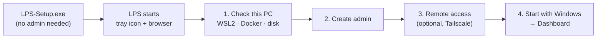

The wizard checks everything LPS needs and tells you how to fix what's missing: the exact command to install WSL2, a link to Docker Desktop, and a **Start Docker Desktop** button. The list refreshes by itself while you fix things.


**Day to day:** right-click the **LPS tray icon** for *Open dashboard*, *Start with Windows* and *Quit LPS*. Quitting LPS doesn't stop running VPS or apps; they keep running in Docker Desktop.

**Updates:** LPS checks GitHub for a new release twice a day and shows a banner when there is one. Click **Install update**: LPS downloads the new installer, checks it against its published SHA-256, installs it silently and restarts in a few seconds. VPS and apps keep running in Docker meanwhile. Turn automatic checks off, or check now, under **Account → Updates** (`lpsd serve -no-update-check` also turns them off). The check only asks GitHub for the latest release; nothing about you or your PC is sent.

**Uninstall:** Windows Settings → Apps → *LPS - Local Personal Server*. Your data (`%ProgramData%\LPS`) is kept so a reinstall picks up your VPS and apps; delete that folder to remove everything.

### Download blocked?

Browsers and Windows warn about programs that are **not code-signed** and that few people have downloaded yet. The LPS installer is built in the open by GitHub Actions from this repository, but it isn't signed yet, so you may see:

| Where | What it says | What to do |
|---|---|---|
| Chrome | *"LPS-Setup… isn't commonly downloaded"* or *"…may be dangerous"* | Open the downloads list (**Ctrl+J**), then choose **Keep** (or **⋮ → Download dangerous file**). |
| Edge | *"…isn't commonly downloaded"* | **⋯ → Keep → Show more → Keep anyway**. |
| Windows SmartScreen | *"Windows protected your PC"* | **More info → Run anyway**. |

To check you got the genuine file, compare its SHA-256 with the `.sha256` file published next to it (on the Releases page and in the Actions artifact):

```powershell
Get-FileHash -Algorithm SHA256 .\LPS-Setup-*.exe
```

Or build the installer yourself from source with `.\build.ps1 installer` (see [Build from source](#build-from-source)); nothing is downloaded then.

**For maintainers: turning on code signing.** Signing makes these warnings go away (immediately with an EV certificate, after some downloads with a standard one). `build.ps1` signs `lps.exe`, `lpsd.exe` and the setup program whenever a certificate is configured:

- **Locally:** set `LPS_SIGN_PFX` to a `.pfx` code-signing certificate and `LPS_SIGN_PASSWORD` to its password, then run `.\build.ps1 installer`.
- **In GitHub Actions:** add the repository secrets `WINDOWS_SIGN_PFX_BASE64` (the `.pfx`, base64-encoded: `[Convert]::ToBase64String([IO.File]::ReadAllBytes("cert.pfx"))`) and `WINDOWS_SIGN_PASSWORD`. Every build is then signed and timestamped.

Certificates from a certificate authority come as (or can be exported to) a `.pfx`. Free or low-cost options for an open-source project, [SignPath Foundation](https://signpath.org/) (free for OSS) and Microsoft's Azure Trusted Signing, don't hand you a `.pfx`: they sign through their own GitHub Action, which would take the place of the *Load the code-signing certificate* step in `.github/workflows/windows-installer.yml`.

## How it works


- **Windows host, Linux VPS.** On Windows, Docker Desktop runs Linux containers inside a lightweight WSL2 VM, so every VPS is real Linux. You SSH in, `apt install`, `git clone` and run things just as you would on a rented VPS.
- **Each VPS** is an Ubuntu 24.04 container with `sshd`. It has its own SSH user (key or password), passwordless sudo for key-only accounts, CPU and memory limits, and a persistent `/home` volume that survives restarts and can be kept when you delete the VPS.
- **Each app** is a project folder on your PC. If it has no `Dockerfile`, LPS detects the project type and writes one for you to review. LPS builds it, runs it, publishes its port, and keeps a log of every deployment.
- **Secure by default.** The dashboard and all published ports bind to `127.0.0.1`. The admin password is hashed with bcrypt, sessions are HttpOnly SameSite=Strict cookies, writes need a CSRF header, logins are rate-limited, and VPS containers are unprivileged with no Docker socket access.

### Terminal in the browser

Every running VPS has a **Terminal** card: click **Open terminal** for a shell as the VPS's user, right in the dashboard. No SSH client or keys are needed, and it works from your phone too over [remote access](#remote-access-with-tailscale). It supports colours, full screen and resizing (`vim`, `htop` and friends work), and `sudo` behaves exactly as it does over SSH.

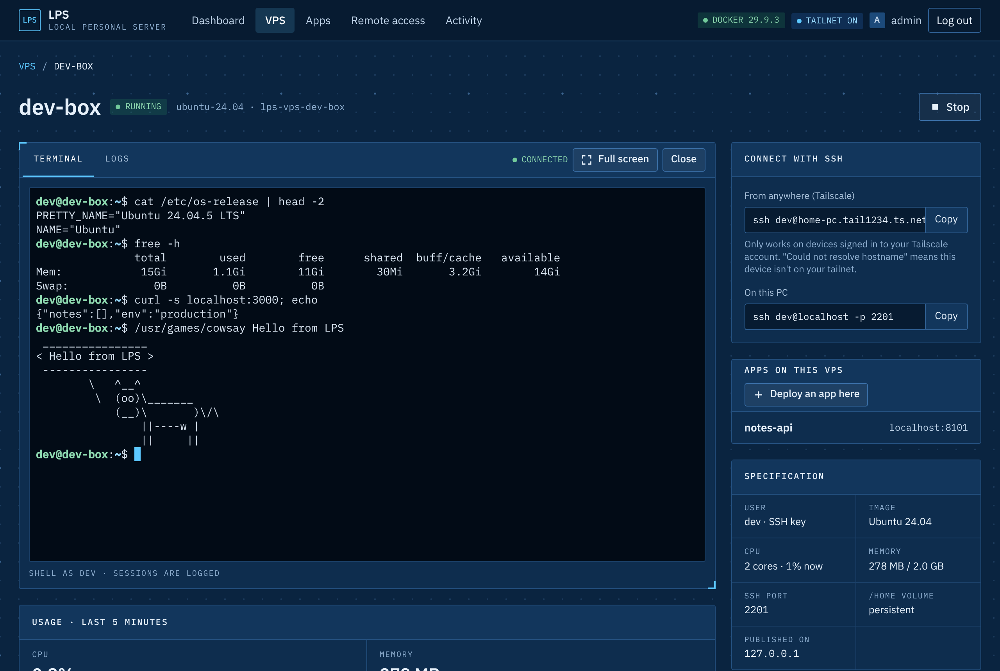

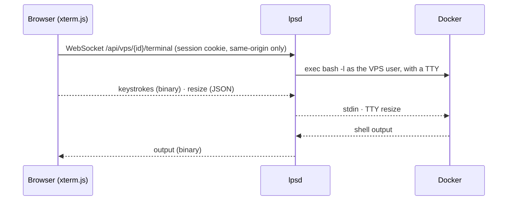

Only the signed-in admin can open a terminal. The WebSocket refuses cross-site requests (Origin check plus the SameSite=Strict session cookie), and each session is logged.

### Creating a VPS

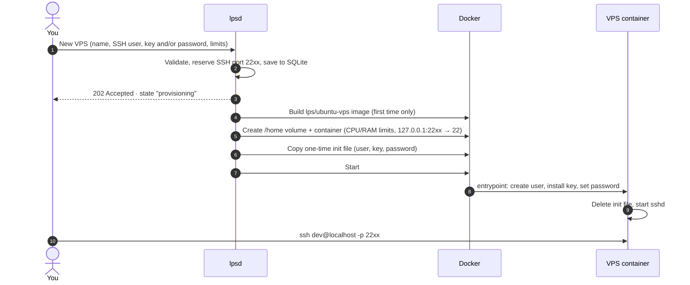

### Deploying an app

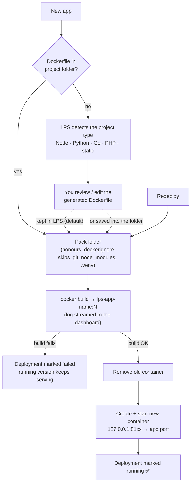

### Deploying an app into a VPS

On the New app form, set **Run on** to one of your VPS (or open a VPS and press **Deploy an app here**). The app then runs as a process inside that VPS, like on a real server, instead of in its own container:

- **Code from a folder on this PC:** copied to `~/apps/<name>` in the VPS on every deploy (`.dockerignore` is honoured; `node_modules`, `.venv` and `.git` are skipped).
- **Code from a folder inside the VPS:** for example a `git clone` you made in the terminal. Redeploy re-runs install and start, so `git pull` and then Redeploy.

LPS fills in **system packages** (installed with apt if missing), an **install command** and a **start command** for the detected project type; edit them as you like. The start command gets the port in `$PORT` and must listen on `0.0.0.0`. LPS keeps it running: it is restarted after a crash and when the VPS restarts. Its output is on the app's **App logs** tab and in `~/.lps/logs/<name>.log` inside the VPS.

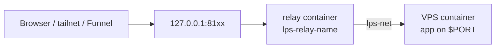

A VPS only publishes its SSH port, so each VPS app gets a tiny relay container that publishes the app's port on the PC. Local, tailnet and public links work as for any app. A VPS can't be deleted while apps run in it, and two apps in one VPS need different ports.

### Deploying from a git repository

On the New app form choose **Code from → A git repository**, paste the HTTPS clone URL (GitHub, GitLab, Gitea, Bitbucket…), optionally a branch, and press **Check repository**. LPS clones it, detects the project type and proposes a Dockerfile or run commands, just like for a folder. It works for apps in their own container and for apps inside a VPS.

- **Every deploy** makes a fresh shallow clone of the branch, so Redeploy always builds the latest commit. Each deployment shows the commit it built.
- **Private repositories:** add an access token with read access, e.g. a GitHub fine-grained token with *Contents: read*. It's stored on this PC and never shown again; replace or remove it on the app's **Git** card.
- **Auto-deploy:** tick *Deploy new commits automatically* and LPS checks the branch every few minutes and deploys new commits. Nothing has to reach your PC from the internet (no webhooks). A commit that fails to deploy isn't retried until you press Redeploy.
- Use HTTPS URLs; SSH URLs (`git@github.com:…`) need keys and aren't supported. Git doesn't need to be installed: LPS has its own git client.

### App addresses by name

Every app can be opened by its name instead of a port number:

| From | Address | Notes |
|---|---|---|
| This PC | `http://myapp.localhost:7070` | Browsers send `*.localhost` to this PC by themselves; nothing to set up. |
| Your devices (Tailscale) | `https://your-pc.ts.net:8080/myapp/` | The app sees requests without the `/myapp` prefix (also sent in `X-Forwarded-Prefix`), and its redirects stay inside `/myapp/`. |

The port addresses (`http://localhost:8100`, `https://your-pc.ts.net:8100`) keep working. Use them for an app that breaks under a path prefix: many single-page apps load files from `/` unless built with a base path (Vite `base`, CRA `homepage`, Next.js `basePath`).

Apps never share an origin with the dashboard: the name addresses live on `*.localhost` hosts and on their own port (`:8080`), and LPS strips its session cookie from every request it passes to an app. So an app's scripts can't act as you in LPS.

### Environment variables and secrets

Every app has an **Environment** tab. Add variables one by one or **paste a `.env` file**, mark the ones that are **secret**, and press **Save & redeploy**.

- **Container apps:** the variables are set on the container.
- **Apps in a VPS:** they're given to the install and start commands. LPS sets `PORT`, `HOST` and `HOME` itself, so those names are refused there; names starting with `LPS_` are reserved everywhere.
- **Secret values** are never sent back to the browser after saving, and never appear in deploy logs or the activity feed (only the variable names do). They are stored in LPS's database on this PC, and anyone who can run `docker inspect` on this PC can read a container's environment.

### Quick public links (Cloudflare)

Share an app with anyone, without Tailscale or a Cloudflare account: on the app's page, turn on **Public link → Cloudflare quick link**. A few seconds later the app has an address like `https://some-random-words.trycloudflare.com`.

- LPS runs Cloudflare's `cloudflared` ([Quick Tunnel](https://developers.cloudflare.com/cloudflare-one/connections/connect-apps/do-more-with-tunnels/trycloudflare/)) in a small container (`lps-cf-<app>`) next to the app. The first time, Docker downloads its image (about 100 MB on disk). It connects **out** to Cloudflare, so no ports are opened on this PC or your router.
- It works for container apps and apps in a VPS. The address stays the same across redeploys. It changes when the link is turned off and on, or after Docker or the PC restarts.
- Anyone with the address can open the app, so only turn it on for apps that are meant to be seen. The dashboard and SSH are never shared this way.
- Quick links are meant for demos and testing: Cloudflare gives them no uptime guarantee and limits them (for example, no Server-Sent Events). For a fixed address, use a Tailscale public link (below) or, later, your own domain.

### Your own domain (Cloudflare Tunnel)

Give apps a permanent address on a domain you own, like `https://blog.yourdomain.com`, reachable by anyone, with HTTPS from Cloudflare. It works on Cloudflare's free plan and doesn't need Tailscale.

1. The domain must use Cloudflare for its DNS ([add it to Cloudflare](https://dash.cloudflare.com/) if it doesn't yet).
2. In Cloudflare, open **My Profile → API Tokens → Create Token → Create Custom Token** and give it these permissions, for your domain (Zone Resources):
   - Account · Cloudflare Tunnel · Edit
   - Zone · DNS · Edit
   - Zone · Zone · Read
3. In LPS, open **Remote access → Your domain · Cloudflare**, paste the token and press **Connect Cloudflare**.
4. On an app's page, under **Public link → Your domain**, enter an address such as `blog.yourdomain.com` and press **Use this address**.

How it works:

- When you connect, LPS creates a Cloudflare Tunnel in your account (named `lps-<pc>-…`) and runs its connector, `cloudflared`, in a container (`lps-cf-tunnel`). The connector only connects **out** to Cloudflare, so no ports are opened on this PC or your router.
- For each address, LPS adds a proxied DNS record (`CNAME` to the tunnel, with the comment *Managed by LPS*) and a route from that address to the app's container, or to the VPS it runs in. Addresses keep working across redeploys.
- LPS never touches DNS records it didn't create. If the address already has a record, LPS asks you to remove it first or pick another name.
- **Remove** on an app deletes its record and route. **Disconnect** deletes every record LPS made, the connector and the tunnel. Deleting an app removes its address.
- The API token is stored in LPS's database on this PC and is never shown again in the dashboard.

### Snapshots

Each VPS page has a **Snapshots** card. A snapshot saves **everything** in the VPS: installed software and settings (the container's files, saved as an image) and `/home` (copied). Snapshots stay in Docker on this PC.

- **Take snapshot** while the VPS runs; it is paused only for the moment its files are saved. For something that writes constantly (a database), stop the VPS first for a perfectly consistent copy.
- **Restore** puts the VPS back exactly as it was: files, users, passwords, SSH keys and host keys. LPS takes a snapshot of the current state first (*Before restoring “…”*), so a restore can be undone. Apps running in the VPS come back by themselves.
- **New VPS from it** makes a copy with a new name and SSH port.
- **Delete** removes a snapshot. Deleting a VPS deletes its snapshots too.
- **Automatic snapshots:** under the snapshot list, choose **Every day** or **Every week**, the hour (in this PC's time) and how many to keep. LPS takes them while it's running. If the PC was off at that time, it takes one when LPS starts again. Only automatic snapshots (marked *auto*) are deleted to keep the newest ones. Snapshots you take yourself stay until you delete them.
- **Export to file** saves a snapshot as one `.lpsnap` file in LPS's data folder (`exports`). From there you can **Download** it or copy it anywhere, such as a USB drive or a backup folder. The file holds the system files, `/home` (with owners and permissions) and the VPS's settings, compressed.
- **Create from a file:** on **New VPS → Or create it from a snapshot file**, pick a `.lpsnap` file (from this PC or another one) and a name. The new VPS has the same files, software, user, password and SSH keys, with its own SSH port. This is how you move a VPS to another PC.

### VPS lifecycle

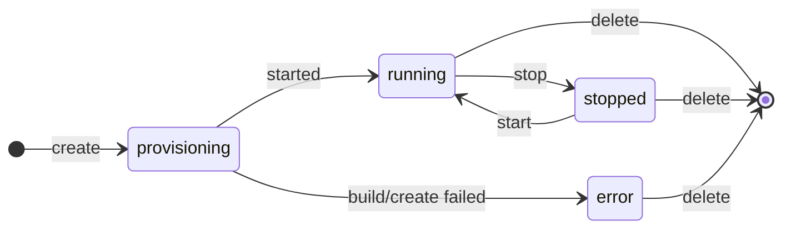

When you delete a VPS you can keep its `/home` volume; creating a VPS with the same name later picks it up again.

### Limits compared with a real VM

A VPS here is a container, not a full VM. It shares the host's Linux kernel (WSL2's kernel on Windows). `systemd` is not running, so start services with their own commands or a process manager like `supervisord`/`pm2`. Running Docker inside a VPS is not supported yet. CPU limits are quotas: `nproc` still shows every host core.

## Remote access with Tailscale

Reach the dashboard, SSH into your VPS and open your apps from your phone or laptop, from anywhere. No domain, no router changes, and nothing is exposed to the internet unless you turn on a public link for an app.

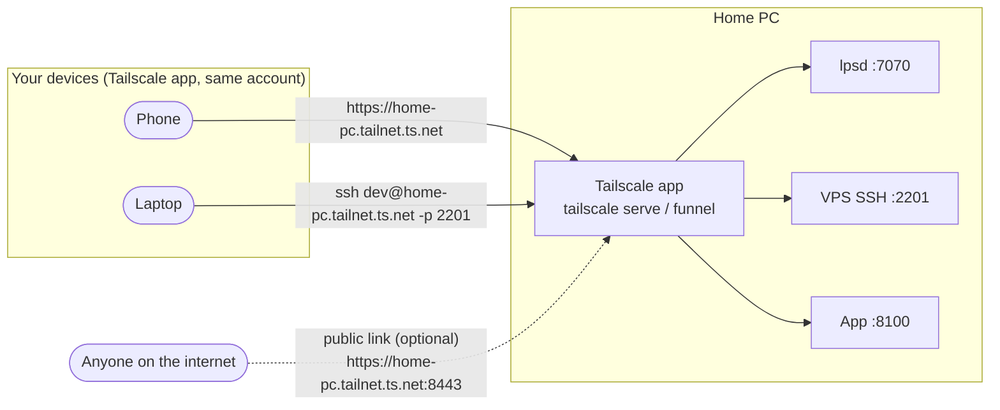

**Set up (about 5 minutes):**

1. Install the [Tailscale app](https://tailscale.com/download) on the home PC and sign in.
2. In the Tailscale admin console, open [DNS](https://login.tailscale.com/admin/dns) and enable **HTTPS Certificates**.
3. In LPS, open **Remote access** and turn it on. LPS publishes the dashboard, every VPS's SSH port and every app on your tailnet, and keeps that in sync as you add or delete things.
4. Install Tailscale on your phone or laptop, sign in with the same account, and open the dashboard address LPS shows (like `https://home-pc.your-tailnet.ts.net`).

| Remote access page | App with a public link | Phone |
|---|---|---|
|  |  |  |

**What gets published:**

| What | Address on your tailnet | Who can reach it |
|---|---|---|
| Dashboard | `https://<pc>.<tailnet>.ts.net` | Your Tailscale devices (and you still log in to LPS) |
| VPS SSH | `ssh <user>@<pc>.<tailnet>.ts.net -p 22xx` | Your Tailscale devices |
| Apps | `https://<pc>.<tailnet>.ts.net:81xx` | Your Tailscale devices |
| App public link (opt-in) | `https://<pc>.<tailnet>.ts.net:8443` or `:10000` | **Anyone** with the link (Tailscale Funnel) |

**Good to know:**

- Public links use [Tailscale Funnel](https://tailscale.com/kb/1223/funnel), which allows only a few ports per machine, so **at most 2 apps can be public at once**. Funnel must be allowed for your tailnet; LPS links to the instructions if it isn't. The dashboard and SSH are never made public.
- LPS only adds and removes the `tailscale serve`/`funnel` settings it created itself. If a port is already used by your own Tailscale settings, LPS leaves it alone and shows a warning.
- Everything still listens on `127.0.0.1`; Tailscale forwards to it, so nothing is opened on your LAN or router.
- Start lpsd with `-no-remote` to turn the integration off completely.

### Troubleshooting

- **"Could not resolve hostname" or the site can't be reached:** the device you're using must have the Tailscale app installed, connected, and signed in to the **same account** as the home PC. `*.ts.net` addresses are private and don't exist for other devices. Check that the PC appears in the device's Tailscale device list. On a Mac, keep **Use Tailscale DNS settings** on, and turn off other VPNs or iCloud Private Relay.
- **It worked before, now it doesn't:** the home PC must be on and awake, with Docker Desktop, Tailscale and lpsd running. Press **Check again** on the Remote access page and look for errors.
- **Sharing with someone without Tailscale:** turn on the app's **Public link**. It can take about a minute to start working.

### Two-factor sign-in

Turn it on before you reach LPS from other devices: open **Account** (click your name at the top right) → **Turn on two-factor sign-in**, scan the QR code with an authenticator app (Google Authenticator, Microsoft Authenticator, 1Password, Bitwarden, Authy…) and enter the code it shows. From then on, signing in needs your password and the app's 6-digit code.

You also get **10 recovery codes**: save them (Copy or Download .txt). Each signs you in once if you don't have your phone; make new ones on the Account page when they run low.

**Lost your phone and your recovery codes?** On the PC where LPS runs, turn two-factor sign-in off from a terminal, then sign in with your password:

```powershell
& "$env:LOCALAPPDATA\Programs\LPS\lpsd.exe" disable-2fa
```

(On Linux/macOS: `lpsd disable-2fa`. Add `-data DIR` if you use a custom data folder, and `-user NAME` if there is more than one account.) Being able to run it on that PC is the proof that it's yours.

## Screenshots

| Create a VPS | VPS details |
|---|---|
|  |  |

| App with deployment log | First-run setup | Phone |
|---|---|---|
|  |  | 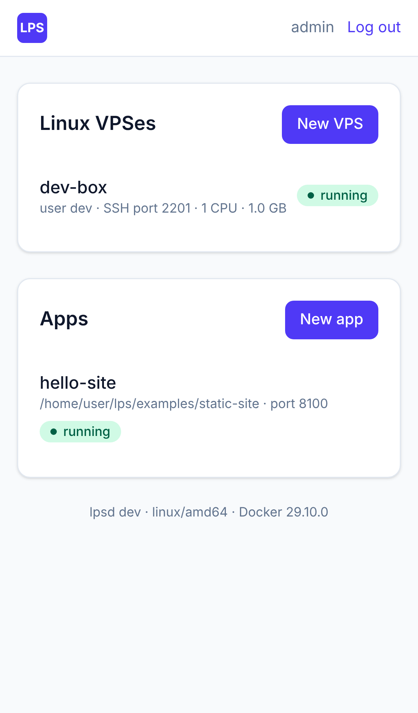 |

## Build from source

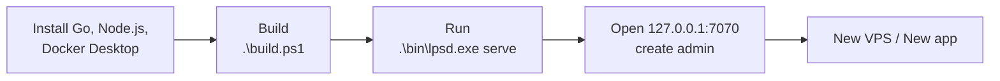

### Windows (PowerShell)

Install these first, then **open a new PowerShell window** so the new commands are found:

- [Docker Desktop](https://www.docker.com/products/docker-desktop/) with the WSL2 backend (the default), and start it.
- [Go 1.24+](https://go.dev/dl/)
- [Node.js 22 LTS](https://nodejs.org/)
- [Git](https://git-scm.com/download/win)

`make` is **not** needed on Windows. Use `build.ps1` instead:

```bash
git clone https://github.com/abrardw/lps.git
```

```bash
cd lps
```

```bash
.\build.ps1
```

```bash
.\bin\lpsd.exe serve
```

If PowerShell says **"running scripts is disabled on this system"**, run the build this way instead:

```bash
powershell -ExecutionPolicy Bypass -File .\build.ps1
```

Or allow local scripts for your user once (it only affects scripts on your PC, not downloaded ones):

```bash
Set-ExecutionPolicy -Scope CurrentUser RemoteSigned
```

Other tasks: `.\build.ps1 run` (build and start), `.\build.ps1 test`, `.\build.ps1 build-all` (release binaries for every OS), `.\build.ps1 installer` (builds `dist\LPS-Setup-<version>.exe`; needs [Inno Setup 6](https://jrsoftware.org/isdl.php)), `.\build.ps1 clean`.

### Linux / macOS

- **Linux:** Docker Engine; your user must be able to use `/var/run/docker.sock`.
- **macOS:** Docker Desktop, OrbStack or Colima.
- Go 1.24+ and Node.js 22+.

```bash
git clone https://github.com/abrardw/lps.git
```

```bash
cd lps
```

```bash
make all
```

```bash
./bin/lpsd serve
```

### First steps

Open <http://127.0.0.1:7070>, create the admin account, then:

1. **New VPS** → choose a name and paste your SSH public key (`ssh-keygen -t ed25519` creates one, including in PowerShell). The first VPS builds the Ubuntu image, which takes a few minutes. After that you get a command like `ssh dev@localhost -p 2201`.
2. **New app** → enter the absolute path to a project folder. If it has no `Dockerfile`, LPS proposes one (see below). Check the port the app listens on, then **Create and deploy**. Try `examples\static-site` (port 80). The app is served at `http://localhost:81xx`.

### Projects without a Dockerfile

LPS looks at the folder and generates a Dockerfile you can review and edit before deploying:

| LPS finds | Template | Port |
|---|---|---|
| `package.json` with `next` | Next.js (build + `npm start`) | 3000 |
| `package.json` with Vite / Create React App / Angular | Static site: build with Node, serve with nginx | 80 |
| `package.json` (other) | Node.js server (`npm start` or `node server.js`) | 3000 |
| `manage.py` | Django with gunicorn | 8000 |
| `fastapi` / `flask` in requirements | FastAPI with uvicorn / Flask with gunicorn | 8000 |
| `requirements.txt` / `pyproject.toml` | Python (`python main.py`) | 8000 |
| `go.mod` | Go (multi-stage build) | 8080 |
| `composer.json` / `index.php` | PHP 8.3 with Apache | 80 |
| `index.html` | Static website with nginx | 80 |

npm, yarn and pnpm are picked from the lockfile. You can switch templates or edit the text freely. By default the Dockerfile is **kept in LPS** and your folder isn't touched; tick **Also save this Dockerfile into the project folder** to get a real `Dockerfile` (and `.dockerignore`) you can commit. LPS never overwrites an existing one. You can edit an LPS-kept Dockerfile later on the app page (**Dockerfile → Save & redeploy**).

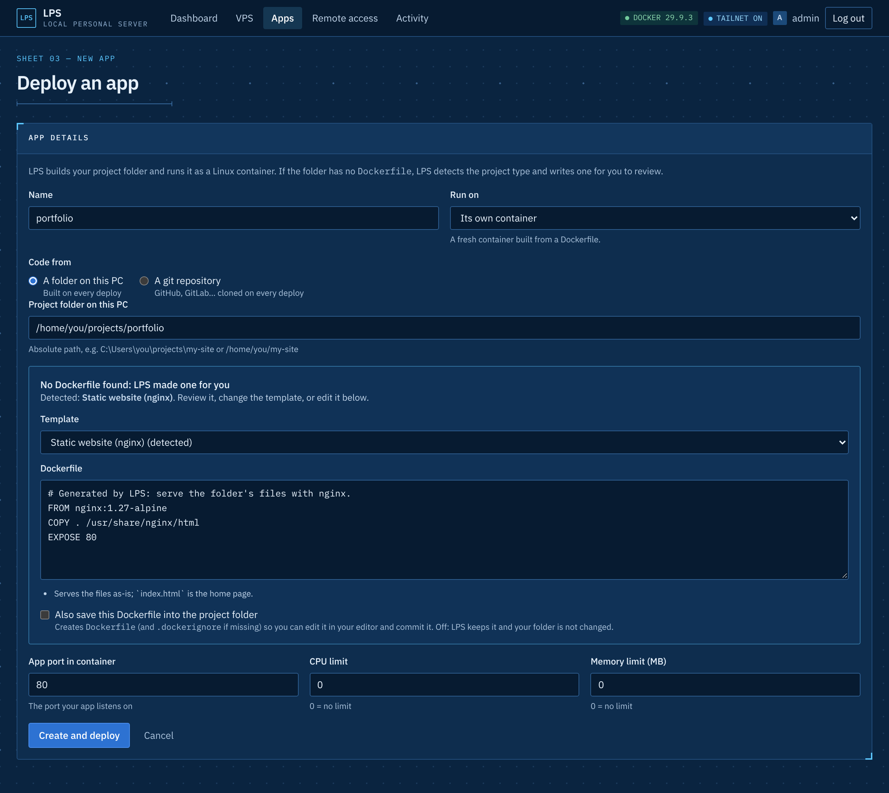

### `lpsd serve` flags

| Flag | Default | Meaning |
|---|---|---|
| `-addr` | `127.0.0.1:7070` | Dashboard address. Keep it on localhost; use [remote access](#remote-access-with-tailscale) to reach it from elsewhere. |
| `-data` | `%ProgramData%\LPS` · `~/.local/share/lps` · `~/Library/Application Support/LPS` | Database and state. |
| `-bind-ip` | `127.0.0.1` | Where VPS SSH ports (2201–2299) and app ports (8100–8199) are published. Use `0.0.0.0` to reach them from your LAN. |
| `-secure-cookies` | `false` | Always mark cookies Secure. Not needed for Tailscale: LPS detects HTTPS through it automatically. |
| `-no-remote` | `false` | Disable the Tailscale remote-access integration. |

### Ports at a glance

| Port range | Used for | Bound to (default) |
|---|---|---|
| `7070` | Dashboard and API | `127.0.0.1` |
| `2201–2299` | SSH into each VPS | `127.0.0.1` (`-bind-ip`) |
| `8100–8199` | Each app's HTTP port (for VPS apps, via its relay) | `127.0.0.1` (`-bind-ip`) |
| `7071` | Apps by name (`/<app>/`), published on the tailnet as `:8080` | `127.0.0.1` (next port after the dashboard, else any free port) |

## Development

Run the checks with `.\build.ps1 test` on Windows, or:

```bash
make test
```

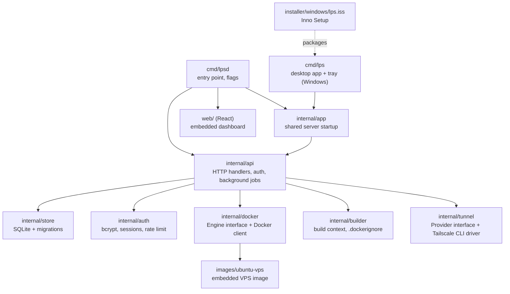

- Frontend: `web/` (React, Vite, TypeScript, TanStack Query, Tailwind). For hot reload, run `npm run dev` in `web/` while `lpsd serve` is running; Vite proxies `/api` to it.
- Database: SQLite through the pure-Go `modernc.org/sqlite` driver, so there's no CGO and cross-compiling to Windows is easy. Migrations live in `internal/store/migrations` and are applied on start. The SQL is kept portable so PostgreSQL can be added as an option later.
- `internal/docker.Engine` and `internal/tunnel.Provider` are interfaces; API tests use in-memory fakes, so `go test ./...` needs neither Docker nor Tailscale.

### Making a release

1. On GitHub, open **Actions → Windows installer → Run workflow**.
2. Leave **Use workflow from** on `master`, type the new version (for example `0.2.0`), tick **pre-release** if it is one, and press **Run workflow**.

The run tests and builds the installer from the current `master`. Only if everything passes does it create the tag `v0.2.0` and the release, with `LPS-Setup-0.2.0.exe`, its `.sha256` and notes generated from the merged pull requests. It refuses a version that isn't like `1.2.3` (or `1.2.3-beta.1`), a tag that already exists, and runs from any branch other than `master`. Leave the version empty to just build an installer.

Publishing a release by hand in the GitHub UI (or pushing a `v*` tag) also works: the installer is attached to that release.

## Roadmap

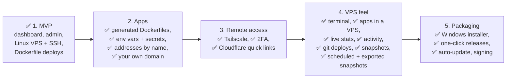

1. ✅ **MVP:** dashboard, admin account, Linux VPS (Ubuntu and SSH) lifecycle, Dockerfile app deploys with logs, SQLite.
2. **Apps:** ✅ generated Dockerfiles for Node, Python, Go, PHP and static sites; ✅ environment variables and secrets; ✅ apps inside a VPS. ✅ addresses by name (`myapp.localhost`, `/myapp/` on the tailnet). ✅ addresses on your own domain through Cloudflare Tunnel.
3. **Remote access (pluggable):** ✅ Tailscale (private access to the dashboard, SSH and apps; Funnel for public links). ✅ two-factor sign-in (TOTP) with recovery codes. ✅ Cloudflare quick links (public demo links, no account). ✅ your own domain through Cloudflare Tunnel.
4. **VPS feel:** ✅ browser terminal, ✅ live CPU/memory stats, ✅ activity feed. ✅ git-URL deploys with auto-deploy, ✅ VPS snapshots (restore, undo, copy). ✅ automatic snapshots and snapshot files (export, import on another PC).
5. **Packaging:** ✅ Windows installer, tray app and setup wizard, ✅ one-click releases, ✅ code signing ready (needs a certificate). ✅ auto-update. Next: Linux (systemd, .deb) and macOS (launchd, .pkg) installers.

## License

[MIT](LICENSE)
