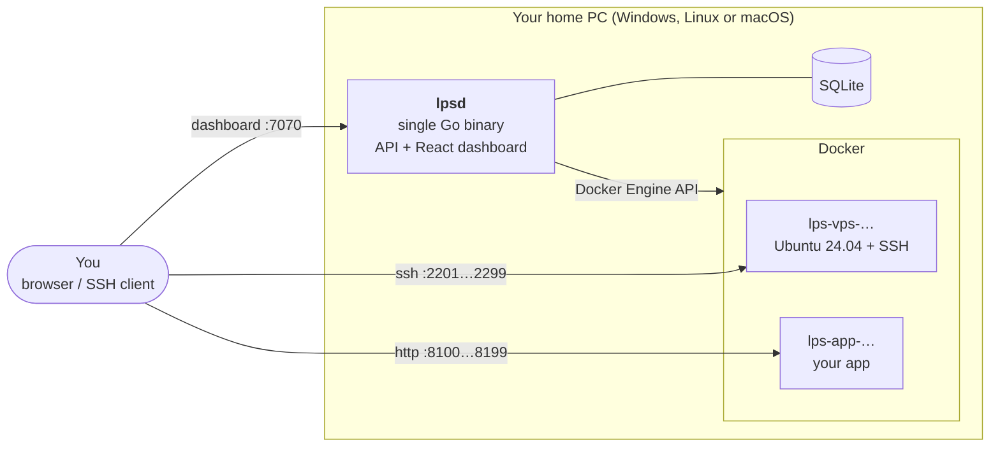

# LPS — Local Personal Server

Turn your home PC into your own VPS host. LPS runs **Linux VPS** (Ubuntu machines you SSH into) and **web app deployments** on your own hardware. You manage them from a web dashboard and can test your apps from anywhere, without renting a server.

> **Status:** early development, but the core features work. See [what's next](#whats-next).

## Features

- **Linux VPS:** Ubuntu 24.04 machines with SSH, a [browser terminal](docs/vps.md#terminal-in-the-browser), CPU and memory limits, and [snapshots](docs/vps.md#snapshots) that you can export to a file.
- **App deploys:** from a folder or a [git repository](docs/apps.md#deploying-from-a-git-repository), in their own container or [inside a VPS](docs/apps.md#deploying-an-app-into-a-vps). LPS [generates a Dockerfile](docs/apps.md#projects-without-a-dockerfile) if your project doesn't have one.
- **Addresses:** open apps [by name](docs/apps.md#app-addresses-by-name) (`myapp.localhost`) or on [your own domain](docs/remote-access.md#your-own-domain-cloudflare-tunnel).
- **Remote access:** through [Tailscale](docs/remote-access.md#tailscale) or [Cloudflare](docs/remote-access.md#cloudflare-quick-links), with [two-factor sign-in](docs/remote-access.md#two-factor-sign-in).
- **Installers:** for Windows (with one-click updates), Debian/Ubuntu and macOS.

## Install

Download the installer for your system from the [Releases page](https://github.com/AbrarDW/lps/releases):

| System | Download | Needs |
|---|---|---|
| Windows 10/11 | `LPS-Setup-<version>.exe` | WSL2 and Docker Desktop (the setup wizard helps you install both) |
| Debian / Ubuntu | `lps_<version>_amd64.deb` or `_arm64.deb` | Docker |
| macOS 11+ | `LPS-<version>-macOS.pkg` | Docker Desktop, OrbStack or Colima |

Run it, and the setup wizard opens at <http://127.0.0.1:7070> to create your admin account. The installers aren't code-signed yet, so your browser or OS may warn you; see [Download blocked?](docs/install.md#download-blocked).

For per-OS details, updates and uninstalling, see the **[install guide](docs/install.md)**.

## Quick start

1. **New VPS:** choose a name and paste your SSH public key (`ssh-keygen -t ed25519` creates one). The first VPS takes a few minutes to build, then you get a command like `ssh dev@localhost -p 2201`.
2. **New app:** enter a project folder or a git URL, check the port, and click **Create and deploy**. To try it out, use `examples/static-site` (port 80).

## How it works

Every VPS and app is a Docker container managed by `lpsd`. On Windows, Docker Desktop runs them in a WSL2 Linux VM, so every VPS is real Linux. By default, everything listens only on `127.0.0.1`. To reach it from other devices, turn on [remote access](docs/remote-access.md).

## Documentation

| Guide | Covers |
|---|---|
| [Install](docs/install.md) | Windows, Linux and macOS setup, updates, uninstalling, download warnings |
| [Linux VPS](docs/vps.md) | Creating a VPS, browser terminal, snapshots, limits compared with a real VM |
| [Apps](docs/apps.md) | Deploying, generated Dockerfiles, git deploys, apps inside a VPS, env vars, addresses |
| [Remote access](docs/remote-access.md) | Tailscale, Cloudflare quick links, your own domain, two-factor sign-in |
| [Reference](docs/reference.md) | `lpsd` flags and commands, ports, security defaults |
| [Development](docs/development.md) | Building from source, project layout, releases, code signing |

## What's next

- Signing the macOS package with an Apple Developer ID
- Running Docker inside a VPS

## License

[MIT](LICENSE)
