# LPS — Local Personal Server

Turn your home PC into your own VPS host. LPS runs **Linux VPSes** (Ubuntu machines you SSH into) and **web app deployments** on your own hardware, managed from a web dashboard, so you can test your apps from anywhere without renting a server.

> Status: **early development**. Linux VPSes, Dockerfile app deploys and [remote access with Tailscale](#remote-access-with-tailscale) work. A reverse proxy with hostnames and the one-click installer are next. See the [roadmap](#roadmap).

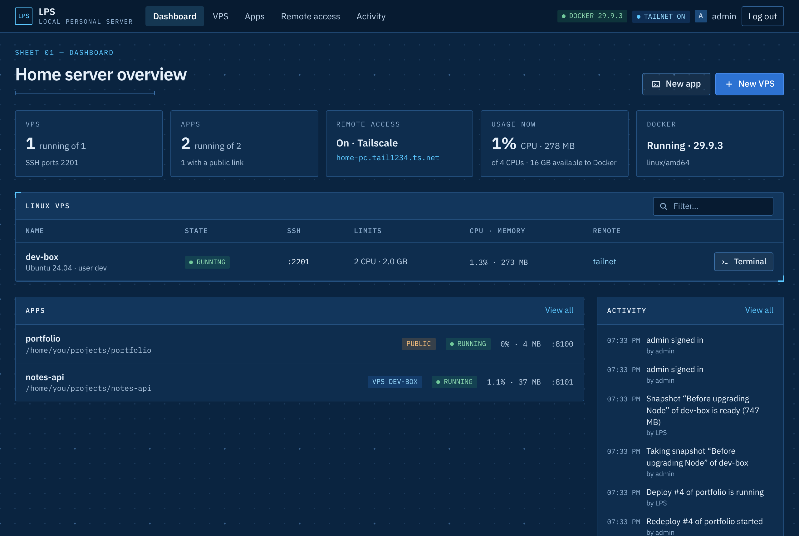

## Install on Windows

1. Download **`LPS-Setup-<version>.exe`** from the [Releases page](https://github.com/AbrarDW/lps/releases) (or, for a development build, from the latest successful **Windows installer** run under the repository's *Actions* tab → *Artifacts*).
2. Run it. It installs for your user only (no administrator rights needed) into `%LOCALAPPDATA%\Programs\LPS`. Because the installer isn't code-signed yet, Windows SmartScreen may warn: choose **More info → Run anyway**.
3. LPS starts with an icon in the system tray and opens the **setup wizard** in your browser.

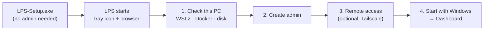

The wizard checks everything LPS needs and tells you how to fix what's missing: the exact command to install WSL2, a link to Docker Desktop, and a **Start Docker Desktop** button. The list refreshes by itself while you fix things.

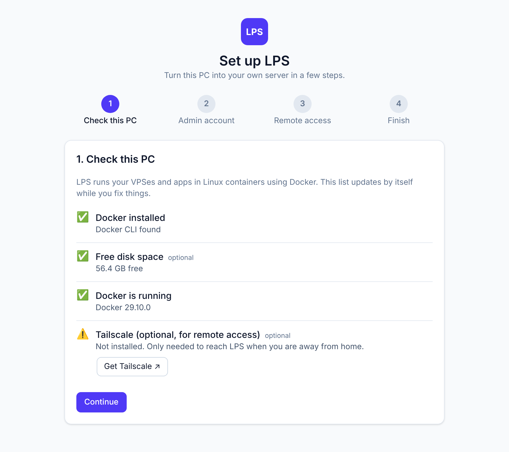

**Day to day:** right-click the **LPS tray icon** for *Open dashboard*, *Start with Windows* and *Quit LPS*. Quitting LPS doesn't stop running VPSes or apps; they keep running in Docker Desktop.

**Uninstall:** Windows Settings → Apps → *LPS - Local Personal Server*. Your data (`%ProgramData%\LPS`) is kept so a reinstall picks up your VPSes and apps; delete that folder to remove everything.

## How it works

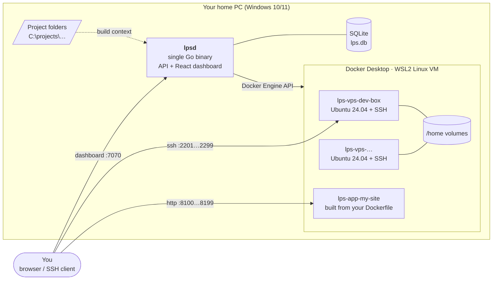

- **Windows host, Linux VPS.** On Windows, Docker Desktop runs Linux containers inside a lightweight WSL2 VM, so every VPS is real Linux. You SSH in, `apt install`, `git clone` and run things just as you would on a rented VPS.
- **Each VPS** is an Ubuntu 24.04 container with `sshd`. It has its own SSH user (key or password), passwordless sudo for key-only accounts, CPU and memory limits, and a persistent `/home` volume that survives restarts and can be kept when you delete the VPS.
- **Each app** is a project folder on your PC. If it has no `Dockerfile`, LPS detects the project type and writes one for you to review. LPS builds it, runs it, publishes its port, and keeps a log of every deployment.
- **Secure by default.** The dashboard and all published ports bind to `127.0.0.1`. The admin password is hashed with bcrypt, sessions are HttpOnly SameSite=Strict cookies, writes need a CSRF header, logins are rate-limited, and VPS containers are unprivileged with no Docker socket access.

### Terminal in the browser

Every running VPS has a **Terminal** card: click **Open terminal** for a shell as the VPS's user, right in the dashboard. No SSH client or keys are needed, and it works from your phone too over [remote access](#remote-access-with-tailscale). It supports colours, full screen and resizing (`vim`, `htop` and friends work), and `sudo` behaves exactly as it does over SSH.


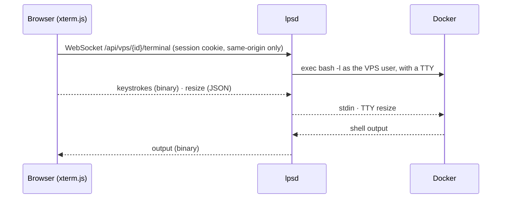

Only the signed-in admin can open a terminal. The WebSocket refuses cross-site requests (Origin check plus the SameSite=Strict session cookie), and each session is logged.

### Creating a VPS

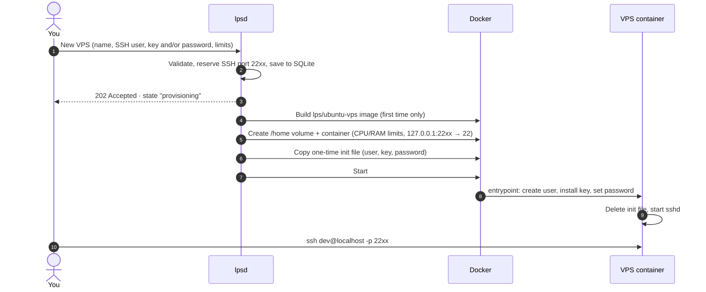

### Deploying an app

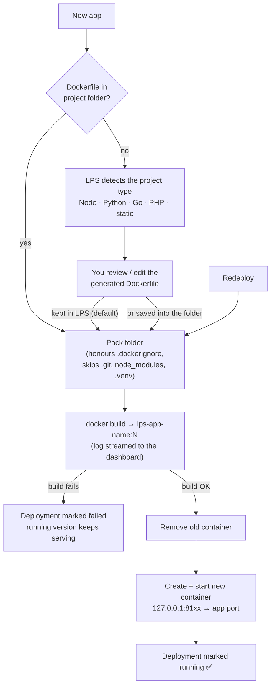

### VPS lifecycle

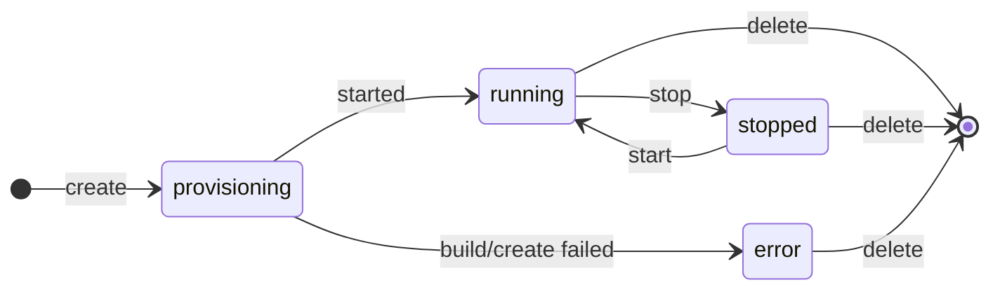

When you delete a VPS you can keep its `/home` volume; creating a VPS with the same name later picks it up again.

### Limits compared with a real VM

A VPS here is a container, not a full VM. It shares the host's Linux kernel (WSL2's kernel on Windows). `systemd` is not running, so start services with their own commands or a process manager like `supervisord`/`pm2`. Running Docker inside a VPS is not supported yet. CPU limits are quotas: `nproc` still shows every host core.

## Remote access with Tailscale

Reach the dashboard, SSH into your VPSes and open your apps from your phone or laptop, from anywhere. No domain, no router changes, and nothing is exposed to the internet unless you turn on a public link for an app.


**Set up (about 5 minutes):**

1. Install the [Tailscale app](https://tailscale.com/download) on the home PC and sign in.
2. In the Tailscale admin console, open [DNS](https://login.tailscale.com/admin/dns) and enable **HTTPS Certificates**.
3. In LPS, open **Remote access** and turn it on. LPS publishes the dashboard, every VPS's SSH port and every app on your tailnet, and keeps that in sync as you add or delete things.
4. Install Tailscale on your phone or laptop, sign in with the same account, and open the dashboard address LPS shows (like `https://home-pc.your-tailnet.ts.net`).

| Remote access page | App with a public link | Phone |
|---|---|---|
| 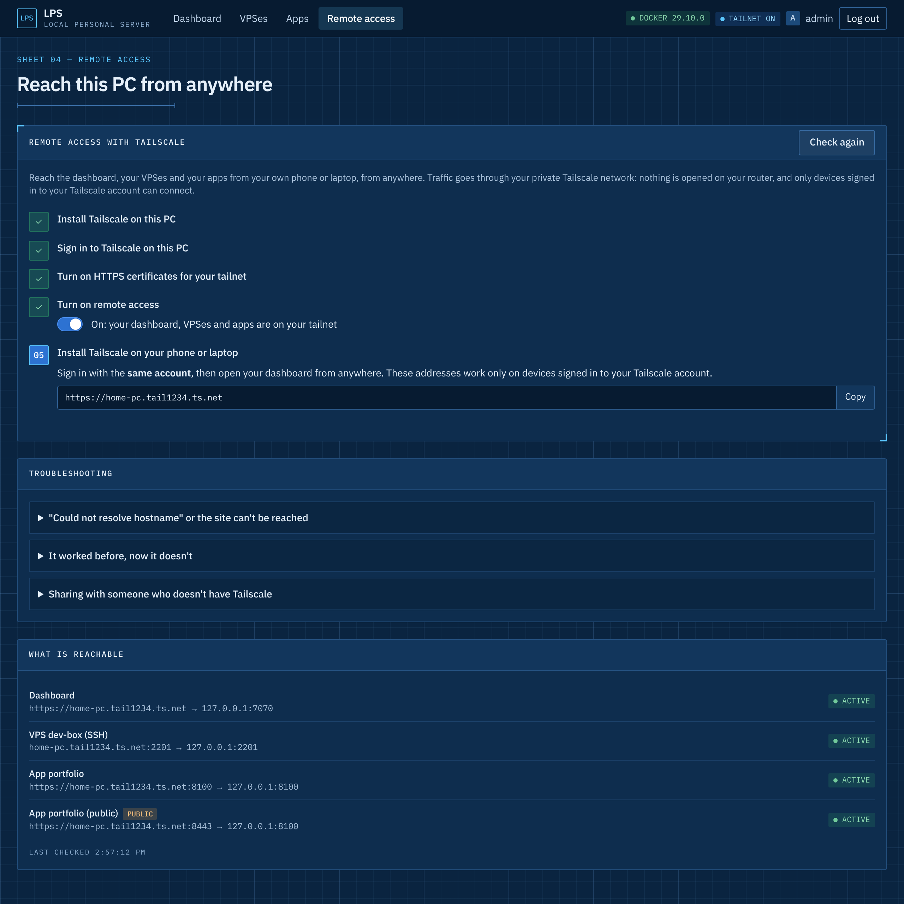 |  |  |

**What gets published:**

| What | Address on your tailnet | Who can reach it |
|---|---|---|
| Dashboard | `https://<pc>.<tailnet>.ts.net` | Your Tailscale devices (and you still log in to LPS) |
| VPS SSH | `ssh <user>@<pc>.<tailnet>.ts.net -p 22xx` | Your Tailscale devices |
| Apps | `https://<pc>.<tailnet>.ts.net:81xx` | Your Tailscale devices |
| App public link (opt-in) | `https://<pc>.<tailnet>.ts.net:8443` or `:10000` | **Anyone** with the link (Tailscale Funnel) |

**Good to know:**

- Public links use [Tailscale Funnel](https://tailscale.com/kb/1223/funnel), which allows only a few ports per machine, so **at most 2 apps can be public at once**. Funnel must be allowed for your tailnet; LPS links to the instructions if it isn't. The dashboard and SSH are never made public.
- LPS only adds and removes the `tailscale serve`/`funnel` settings it created itself. If a port is already used by your own Tailscale settings, LPS leaves it alone and shows a warning.
- Everything still listens on `127.0.0.1`; Tailscale forwards to it, so nothing is opened on your LAN or router.
- Start lpsd with `-no-remote` to turn the integration off completely.

### Troubleshooting

- **"Could not resolve hostname" or the site can't be reached:** the device you're using must have the Tailscale app installed, connected, and signed in to the **same account** as the home PC. `*.ts.net` addresses are private and don't exist for other devices. Check that the PC appears in the device's Tailscale device list. On a Mac, keep **Use Tailscale DNS settings** on, and turn off other VPNs or iCloud Private Relay.
- **It worked before, now it doesn't:** the home PC must be on and awake, with Docker Desktop, Tailscale and lpsd running. Press **Check again** on the Remote access page and look for errors.
- **Sharing with someone without Tailscale:** turn on the app's **Public link**. It can take about a minute to start working.

## Screenshots

| Create a VPS | VPS details |
|---|---|
|  | 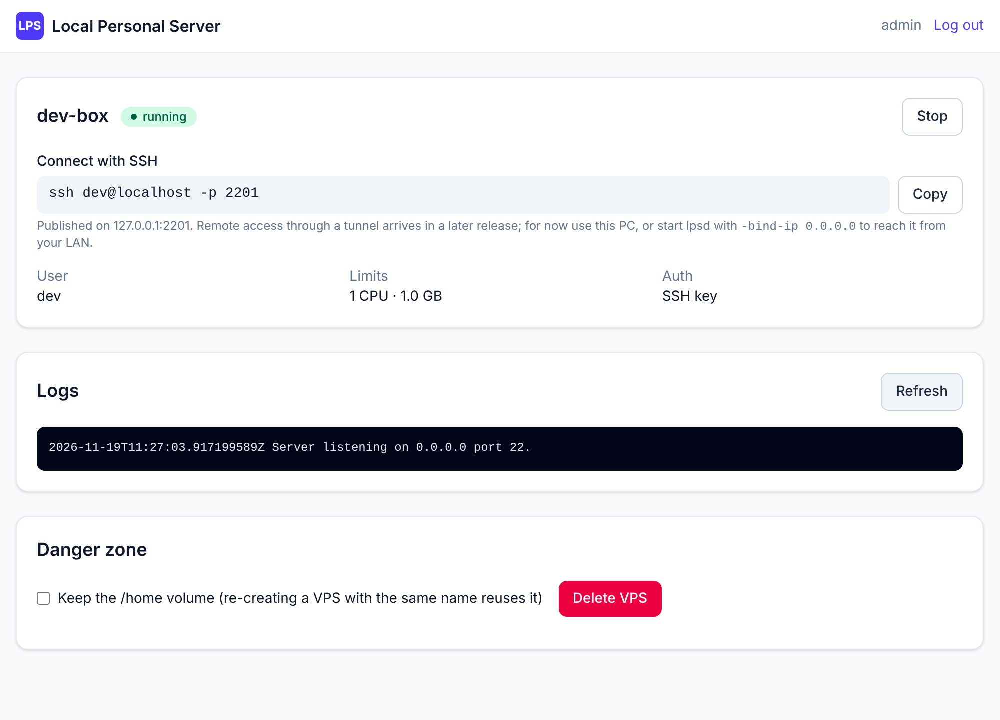 |

| App with deployment log | First-run setup | Phone |
|---|---|---|
| 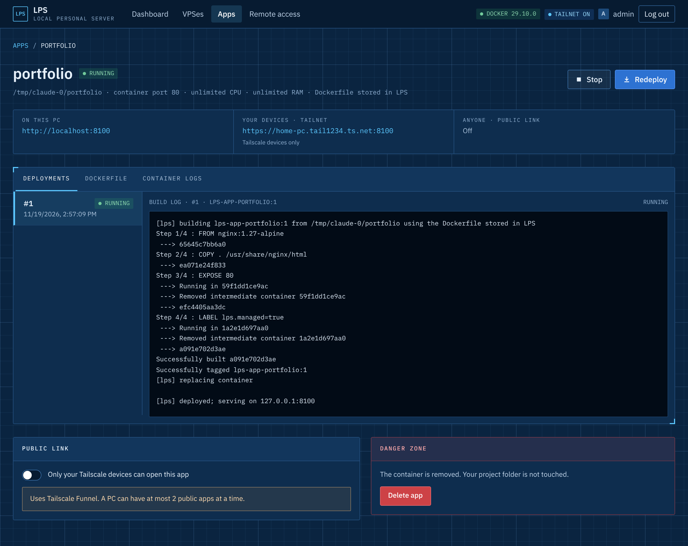 | 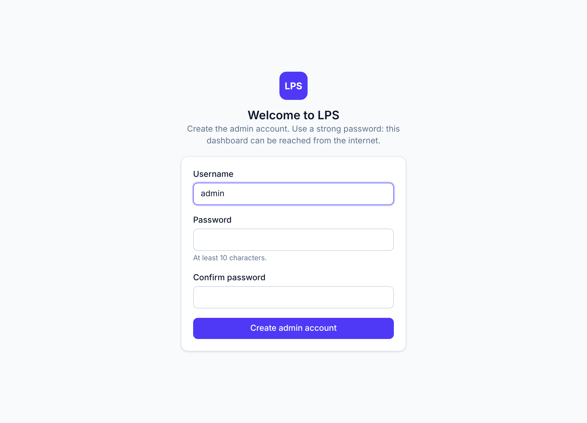 |  |

## Build from source

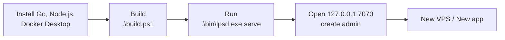

### Windows (PowerShell)

Install these first, then **open a new PowerShell window** so the new commands are found:

- [Docker Desktop](https://www.docker.com/products/docker-desktop/) with the WSL2 backend (the default), and start it.
- [Go 1.24+](https://go.dev/dl/)
- [Node.js 22 LTS](https://nodejs.org/)
- [Git](https://git-scm.com/download/win)

`make` is **not** needed on Windows. Use `build.ps1` instead:

```bash
git clone https://github.com/abrardw/lps.git
```

```bash
cd lps
```

```bash
.\build.ps1
```

```bash
.\bin\lpsd.exe serve
```

If PowerShell says **"running scripts is disabled on this system"**, run the build this way instead:

```bash
powershell -ExecutionPolicy Bypass -File .\build.ps1
```

Or allow local scripts for your user once (it only affects scripts on your PC, not downloaded ones):

```bash
Set-ExecutionPolicy -Scope CurrentUser RemoteSigned
```

Other tasks: `.\build.ps1 run` (build and start), `.\build.ps1 test`, `.\build.ps1 build-all` (release binaries for every OS), `.\build.ps1 installer` (builds `dist\LPS-Setup-<version>.exe`; needs [Inno Setup 6](https://jrsoftware.org/isdl.php)), `.\build.ps1 clean`.

### Linux / macOS

- **Linux:** Docker Engine; your user must be able to use `/var/run/docker.sock`.
- **macOS:** Docker Desktop, OrbStack or Colima.
- Go 1.24+ and Node.js 22+.

```bash
git clone https://github.com/abrardw/lps.git
```

```bash
cd lps
```

```bash
make all
```

```bash
./bin/lpsd serve
```

### First steps

Open <http://127.0.0.1:7070>, create the admin account, then:

1. **New VPS** → choose a name and paste your SSH public key (`ssh-keygen -t ed25519` creates one, including in PowerShell). The first VPS builds the Ubuntu image, which takes a few minutes. After that you get a command like `ssh dev@localhost -p 2201`.
2. **New app** → enter the absolute path to a project folder. If it has no `Dockerfile`, LPS proposes one (see below). Check the port the app listens on, then **Create and deploy**. Try `examples\static-site` (port 80). The app is served at `http://localhost:81xx`.

### Projects without a Dockerfile

LPS looks at the folder and generates a Dockerfile you can review and edit before deploying:

| LPS finds | Template | Port |
|---|---|---|
| `package.json` with `next` | Next.js (build + `npm start`) | 3000 |
| `package.json` with Vite / Create React App / Angular | Static site: build with Node, serve with nginx | 80 |
| `package.json` (other) | Node.js server (`npm start` or `node server.js`) | 3000 |
| `manage.py` | Django with gunicorn | 8000 |
| `fastapi` / `flask` in requirements | FastAPI with uvicorn / Flask with gunicorn | 8000 |
| `requirements.txt` / `pyproject.toml` | Python (`python main.py`) | 8000 |
| `go.mod` | Go (multi-stage build) | 8080 |
| `composer.json` / `index.php` | PHP 8.3 with Apache | 80 |
| `index.html` | Static website with nginx | 80 |

npm, yarn and pnpm are picked from the lockfile. You can switch templates or edit the text freely. By default the Dockerfile is **kept in LPS** and your folder isn't touched; tick **Also save this Dockerfile into the project folder** to get a real `Dockerfile` (and `.dockerignore`) you can commit. LPS never overwrites an existing one. You can edit an LPS-kept Dockerfile later on the app page (**Dockerfile → Save & redeploy**).


### `lpsd serve` flags

| Flag | Default | Meaning |
|---|---|---|
| `-addr` | `127.0.0.1:7070` | Dashboard address. Keep it on localhost; use [remote access](#remote-access-with-tailscale) to reach it from elsewhere. |
| `-data` | `%ProgramData%\LPS` · `~/.local/share/lps` · `~/Library/Application Support/LPS` | Database and state. |
| `-bind-ip` | `127.0.0.1` | Where VPS SSH ports (2201–2299) and app ports (8100–8199) are published. Use `0.0.0.0` to reach them from your LAN. |
| `-secure-cookies` | `false` | Always mark cookies Secure. Not needed for Tailscale: LPS detects HTTPS through it automatically. |
| `-no-remote` | `false` | Disable the Tailscale remote-access integration. |

### Ports at a glance

| Port range | Used for | Bound to (default) |
|---|---|---|
| `7070` | Dashboard and API | `127.0.0.1` |
| `2201–2299` | SSH into each VPS | `127.0.0.1` (`-bind-ip`) |
| `8100–8199` | Each app's HTTP port | `127.0.0.1` (`-bind-ip`) |

## Development

Run the checks with `.\build.ps1 test` on Windows, or:

```bash
make test
```

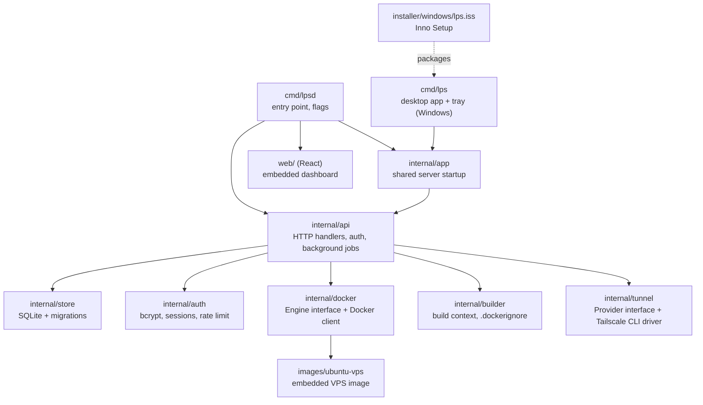

- Frontend: `web/` (React, Vite, TypeScript, TanStack Query, Tailwind). For hot reload, run `npm run dev` in `web/` while `lpsd serve` is running; Vite proxies `/api` to it.
- Database: SQLite through the pure-Go `modernc.org/sqlite` driver, so there's no CGO and cross-compiling to Windows is easy. Migrations live in `internal/store/migrations` and are applied on start. The SQL is kept portable so PostgreSQL can be added as an option later.
- `internal/docker.Engine` and `internal/tunnel.Provider` are interfaces; API tests use in-memory fakes, so `go test ./...` needs neither Docker nor Tailscale.

## Roadmap

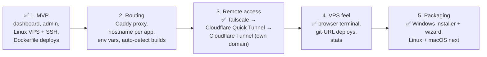

1. ✅ **MVP:** dashboard, admin account, Linux VPS (Ubuntu and SSH) lifecycle, Dockerfile app deploys with logs, SQLite.
2. **Routing:** a Caddy reverse proxy with a hostname per app and per VPS HTTP port, env vars, and auto-detected builds (Node, Python, static) without a Dockerfile.
3. **Remote access (pluggable):** ✅ Tailscale (no domain needed, private access to the dashboard, SSH and apps; Funnel for public links). Next: Cloudflare Quick Tunnel (instant public demo links), then Cloudflare Tunnel with your own domain. Optional 2FA (TOTP) before anything is exposed.
4. **VPS feel:** ✅ browser terminal. Next: git-URL deploys and webhooks, and resource stats.
5. **Packaging:** ✅ Windows installer, tray app and setup wizard (checks WSL2 and Docker, creates the admin, offers remote access, start with Windows). Next: code signing, auto-update, and Linux (systemd, .deb) and macOS (launchd, .pkg) installers.

## License

[MIT](LICENSE)
