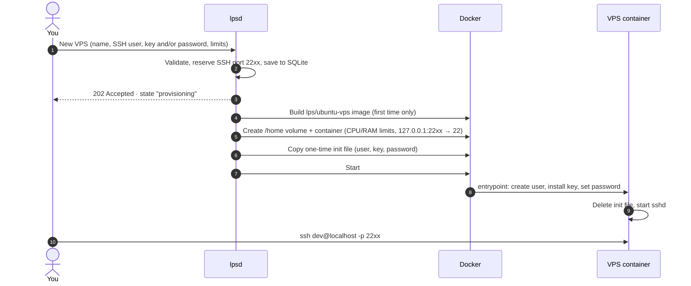
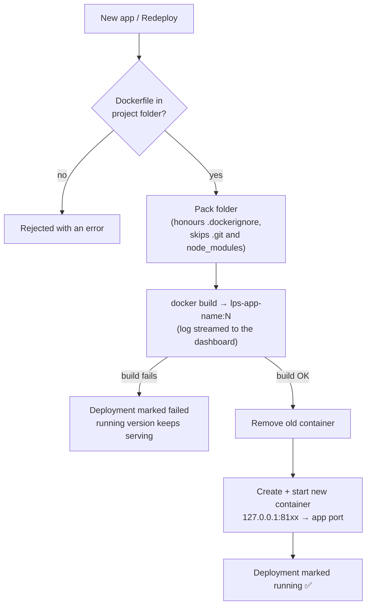
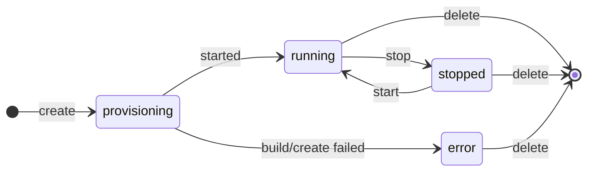
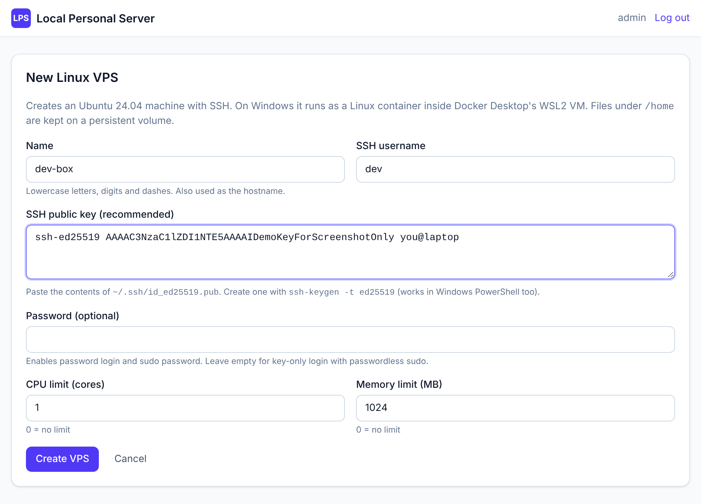
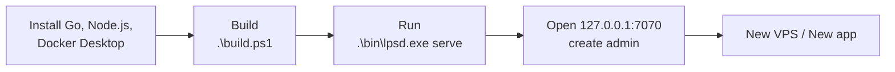
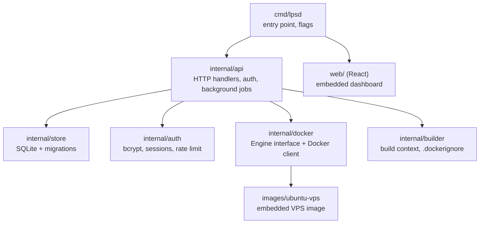
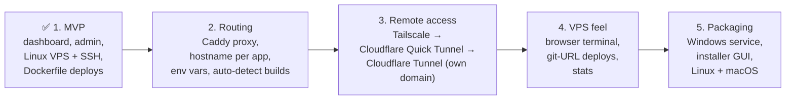

# LPS — Local Personal Server

Turn your home PC into your own VPS host. LPS runs **Linux VPSes** (Ubuntu machines you SSH into) and **web app deployments** on your own hardware, managed from a web dashboard, so you can test your apps from anywhere without renting a server.

> Status: **early development (milestone 1)**. Linux VPSes and Dockerfile app deploys work locally. A reverse proxy with hostnames, remote access and the one-click installer are next. See the [roadmap](#roadmap).


## How it works

```mermaid
flowchart LR
    you(["You<br/>browser / SSH client"])

    subgraph pc["Your home PC (Windows 10/11)"]
        lpsd["<b>lpsd</b><br/>single Go binary<br/>API + React dashboard"]
        db[("SQLite<br/>lps.db")]
        subgraph docker["Docker Desktop · WSL2 Linux VM"]
            vps1["lps-vps-dev-box<br/>Ubuntu 24.04 + SSH"]
            vps2["lps-vps-…<br/>Ubuntu 24.04 + SSH"]
            app1["lps-app-my-site<br/>built from your Dockerfile"]
            vol[("/home volumes")]
        end
        src[/"Project folders<br/>C:\projects\…"/]
    end

    you -- "dashboard :7070" --> lpsd
    you -- "ssh :2201…2299" --> vps1
    you -- "http :8100…8199" --> app1
    lpsd --- db
    lpsd -- "Docker Engine API" --> docker
    src -. "build context" .-> lpsd
    vps1 --- vol
    vps2 --- vol
```



- **Windows host, Linux VPS.** On Windows, Docker Desktop runs Linux containers inside a lightweight WSL2 VM, so every VPS is real Linux. You SSH in, `apt install`, `git clone` and run things just as you would on a rented VPS.
- **Each VPS** is an Ubuntu 24.04 container with `sshd`. It has its own SSH user (key or password), passwordless sudo for key-only accounts, CPU and memory limits, and a persistent `/home` volume that survives restarts and can be kept when you delete the VPS.
- **Each app** is a folder on your PC with a `Dockerfile`. LPS builds it, runs it, publishes its port, and keeps a log of every deployment.
- **Secure by default.** The dashboard and all published ports bind to `127.0.0.1`. The admin password is hashed with bcrypt, sessions are HttpOnly SameSite=Strict cookies, writes need a CSRF header, logins are rate-limited, and VPS containers are unprivileged with no Docker socket access.

### Creating a VPS



### Deploying an app



### VPS lifecycle



When you delete a VPS you can keep its `/home` volume; creating a VPS with the same name later picks it up again.

### Limits compared with a real VM

A VPS here is a container, not a full VM. It shares the host's Linux kernel (WSL2's kernel on Windows). `systemd` is not running, so start services with their own commands or a process manager like `supervisord`/`pm2`. Running Docker inside a VPS is not supported yet. CPU limits are quotas: `nproc` still shows every host core.

## Screenshots

| Create a VPS | VPS details |
|---|---|
|  |  |

| App with deployment log | First-run setup | Phone |
|---|---|---|
|  |  |  |

## Quick start (from source)



### Windows (PowerShell)

Install these first, then **open a new PowerShell window** so the new commands are found:

- [Docker Desktop](https://www.docker.com/products/docker-desktop/) with the WSL2 backend (the default), and start it.
- [Go 1.24+](https://go.dev/dl/)
- [Node.js 22 LTS](https://nodejs.org/)
- [Git](https://git-scm.com/download/win)

`make` is **not** needed on Windows. Use `build.ps1` instead:

```bash
git clone https://github.com/abrardw/lps.git
```

```bash
cd lps
```

```bash
.\build.ps1
```

```bash
.\bin\lpsd.exe serve
```

If PowerShell says **"running scripts is disabled on this system"**, run the build this way instead:

```bash
powershell -ExecutionPolicy Bypass -File .\build.ps1
```

Or allow local scripts for your user once (it only affects scripts on your PC, not downloaded ones):

```bash
Set-ExecutionPolicy -Scope CurrentUser RemoteSigned
```

Other tasks: `.\build.ps1 run` (build and start), `.\build.ps1 test`, `.\build.ps1 build-all` (release binaries for every OS), `.\build.ps1 clean`.

### Linux / macOS

- **Linux:** Docker Engine; your user must be able to use `/var/run/docker.sock`.
- **macOS:** Docker Desktop, OrbStack or Colima.
- Go 1.24+ and Node.js 22+.

```bash
git clone https://github.com/abrardw/lps.git
```

```bash
cd lps
```

```bash
make all
```

```bash
./bin/lpsd serve
```

### First steps

Open <http://127.0.0.1:7070>, create the admin account, then:

1. **New VPS** → choose a name and paste your SSH public key (`ssh-keygen -t ed25519` creates one, including in PowerShell). The first VPS builds the Ubuntu image, which takes a few minutes. After that you get a command like `ssh dev@localhost -p 2201`.
2. **New app** → enter the absolute path to a project folder with a `Dockerfile` and the port the app listens on. Try `examples\static-site` (port 80). The app is served at `http://localhost:81xx`.

### `lpsd serve` flags

| Flag | Default | Meaning |
|---|---|---|
| `-addr` | `127.0.0.1:7070` | Dashboard address. Keep it on localhost and expose it through a tunnel (coming soon). |
| `-data` | `%ProgramData%\LPS` · `~/.local/share/lps` · `~/Library/Application Support/LPS` | Database and state. |
| `-bind-ip` | `127.0.0.1` | Where VPS SSH ports (2201–2299) and app ports (8100–8199) are published. Use `0.0.0.0` to reach them from your LAN. |
| `-secure-cookies` | `false` | Set this when the dashboard is served over HTTPS. |

### Ports at a glance

| Port range | Used for | Bound to (default) |
|---|---|---|
| `7070` | Dashboard and API | `127.0.0.1` |
| `2201–2299` | SSH into each VPS | `127.0.0.1` (`-bind-ip`) |
| `8100–8199` | Each app's HTTP port | `127.0.0.1` (`-bind-ip`) |

## Development

Run the checks with `.\build.ps1 test` on Windows, or:

```bash
make test
```



- Frontend: `web/` (React, Vite, TypeScript, TanStack Query, Tailwind). For hot reload, run `npm run dev` in `web/` while `lpsd serve` is running; Vite proxies `/api` to it.
- Database: SQLite through the pure-Go `modernc.org/sqlite` driver, so there's no CGO and cross-compiling to Windows is easy. Migrations live in `internal/store/migrations` and are applied on start. The SQL is kept portable so PostgreSQL can be added as an option later.
- `internal/docker.Engine` is an interface; API tests use an in-memory fake, so `go test ./...` needs no Docker.

## Roadmap



1. ✅ **MVP:** dashboard, admin account, Linux VPS (Ubuntu and SSH) lifecycle, Dockerfile app deploys with logs, SQLite.
2. **Routing:** a Caddy reverse proxy with a hostname per app and per VPS HTTP port, env vars, and auto-detected builds (Node, Python, static) without a Dockerfile.
3. **Remote access (pluggable):** Tailscale first (no domain needed, private access to the dashboard, SSH and apps; Funnel for a public link), then Cloudflare Quick Tunnel (instant public demo links), then Cloudflare Tunnel with your own domain. Optional 2FA (TOTP) before anything is exposed.
4. **VPS feel:** a browser terminal, git-URL deploys and webhooks, and resource stats.
5. **Packaging:** run as a Windows service, plus a **one-click/step-by-step installer GUI** (checks WSL2 and Docker, creates the admin, sets up remote access). Then Linux (systemd, .deb) and macOS (launchd, .pkg) installers.

## License

[MIT](LICENSE)
