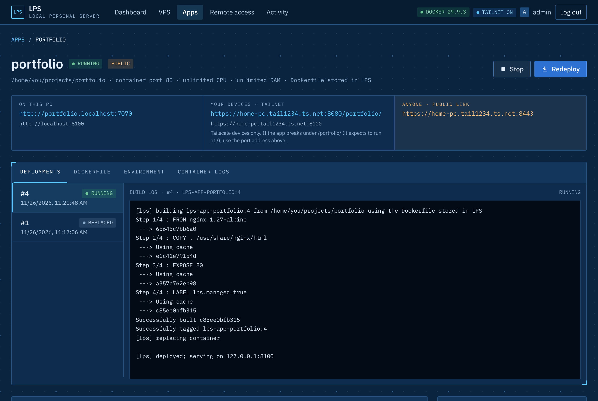
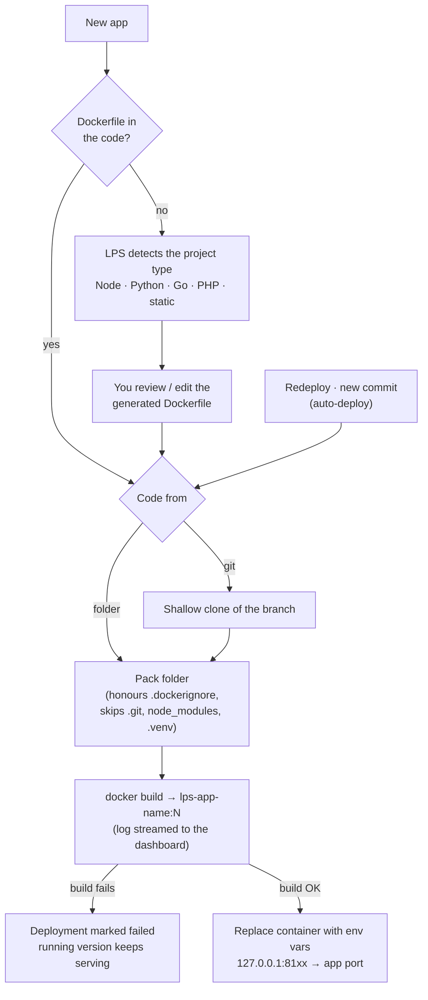
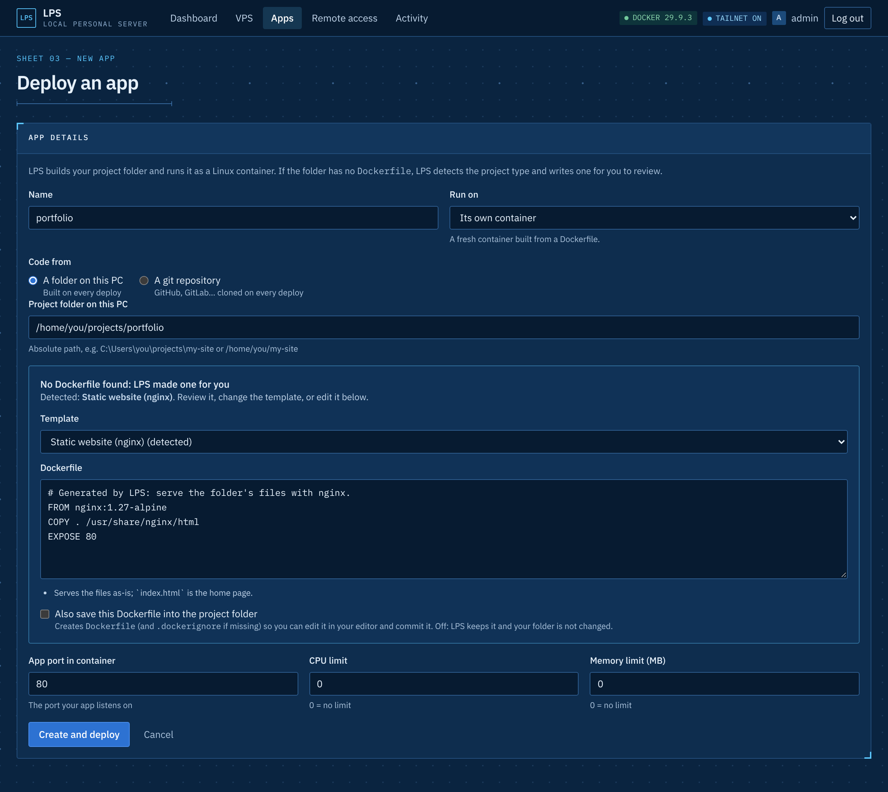
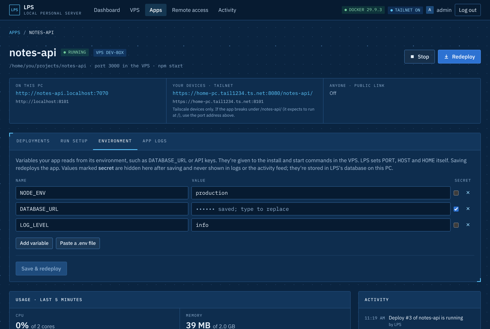

# Deploying apps

An app is code from a **folder on this PC** or a **git repository**. LPS can run it in **its own container** (the default) or **inside one of your VPS**. Every app keeps a log of each deployment.

- [Deploying an app](#deploying-an-app)
- [Projects without a Dockerfile](#projects-without-a-dockerfile)
- [Deploying from a git repository](#deploying-from-a-git-repository)
- [Deploying an app into a VPS](#deploying-an-app-into-a-vps)
- [Environment variables and secrets](#environment-variables-and-secrets)
- [App addresses by name](#app-addresses-by-name)

## Deploying an app

Click **New app** and enter the absolute path to a project folder. Check the port the app listens on, then click **Create and deploy**. To try it out, use `examples/static-site` (port 80). The app is served at `http://localhost:81xx`.

## Projects without a Dockerfile

If the folder has no Dockerfile, LPS writes one that you can review and edit before deploying:

| LPS finds | Template | Port |
|---|---|---|
| `package.json` with `next` | Next.js (build + `npm start`) | 3000 |
| `package.json` with Vite / Create React App / Angular | Static site: build with Node, serve with nginx | 80 |
| `package.json` (other) | Node.js server (`npm start` or `node server.js`) | 3000 |
| `manage.py` | Django with gunicorn | 8000 |
| `fastapi` / `flask` in requirements | FastAPI with uvicorn / Flask with gunicorn | 8000 |
| `requirements.txt` / `pyproject.toml` | Python (`python main.py`) | 8000 |
| `go.mod` | Go (multi-stage build) | 8080 |
| `composer.json` / `index.php` | PHP 8.3 with Apache | 80 |
| `index.html` | Static website with nginx | 80 |

LPS picks npm, yarn or pnpm from the lockfile. By default the Dockerfile is **kept in LPS** and your folder isn't touched. To get a real `Dockerfile` (and `.dockerignore`) you can commit, tick **Also save this Dockerfile into the project folder**. LPS never overwrites an existing one. To edit a Dockerfile kept in LPS later, use **Dockerfile → Save & redeploy** on the app page.

## Deploying from a git repository

On the New app form, choose **Code from → A git repository**, paste the HTTPS clone URL (GitHub, GitLab, Gitea, Bitbucket…), optionally a branch, and click **Check repository**. LPS clones it and proposes a Dockerfile or run commands, just as it does for a folder.

- **Every deploy** makes a fresh shallow clone, so Redeploy always builds the latest commit. Each deployment shows the commit it built.
- **Private repositories:** add an access token with read access, for example a GitHub fine-grained token with *Contents: read*. It's stored on this PC and never shown again; replace or remove it on the app's **Git** card.
- **Auto-deploy:** tick *Deploy new commits automatically* and LPS checks the branch every few minutes. It doesn't use webhooks, so nothing has to reach your PC from the internet. If a commit fails to deploy, LPS doesn't retry it until you click Redeploy.
- Only HTTPS URLs are supported, not SSH URLs (`git@github.com:…`). You don't need Git installed: LPS has its own git client.

## Deploying an app into a VPS

Set **Run on** to one of your VPS (or open a VPS and click **Deploy an app here**). The app then runs as a process inside that VPS, like on a real server:

- **Code from a folder on this PC** is copied to `~/apps/<name>` in the VPS on every deploy.
- **Code from a folder inside the VPS** works too, for example a `git clone` you made in the terminal. To update it, run `git pull` and then click Redeploy.

LPS fills in **system packages** (installed with apt if missing), an **install command** and a **start command** for the detected project type. You can edit any of them. The start command gets the port in `$PORT` and must listen on `0.0.0.0`. LPS restarts the app after a crash and when the VPS restarts. Its output is on the **App logs** tab and in `~/.lps/logs/<name>.log` inside the VPS.

A VPS publishes only its SSH port, so each VPS app gets a small relay container (`lps-relay-<name>`) that publishes the app's port on the PC. A VPS can't be deleted while apps run in it, and two apps in one VPS need different ports.

## Environment variables and secrets

On an app's **Environment** tab, add variables one by one or **paste a `.env` file**. Mark the secret ones as **secret**, then click **Save & redeploy**.

- **Container apps:** the variables are set on the container.
- **Apps in a VPS:** the variables are passed to the install and start commands. LPS sets `PORT`, `HOST` and `HOME` itself, so you can't use those names.
- Names starting with `LPS_` are reserved.
- **Secret values** are never sent back to the browser, and never appear in deploy logs or the activity feed. They are stored in LPS's database on this PC. Note that anyone who can run `docker inspect` on this PC can read a container's environment.

## App addresses by name

You can open every app by its name instead of a port number:

| From | Address | Notes |
|---|---|---|
| This PC | `http://myapp.localhost:7070` | Browsers send `*.localhost` to this PC on their own, so there's nothing to set up. |
| Your devices (Tailscale) | `https://your-pc.ts.net:8080/myapp/` | LPS strips the `/myapp` prefix before passing requests to the app (and sends it in `X-Forwarded-Prefix`). The app's redirects stay inside `/myapp/`. |

Port addresses (`http://localhost:8100`) keep working. Use them for apps that break under a path prefix; many single-page apps need a base path to be set (Vite `base`, CRA `homepage`, Next.js `basePath`).

Apps never share an origin with the dashboard, and LPS strips its session cookie from every request it passes to an app, so an app's scripts can't act as you in LPS.

To share an app outside your own devices, see [Remote access](remote-access.md).
