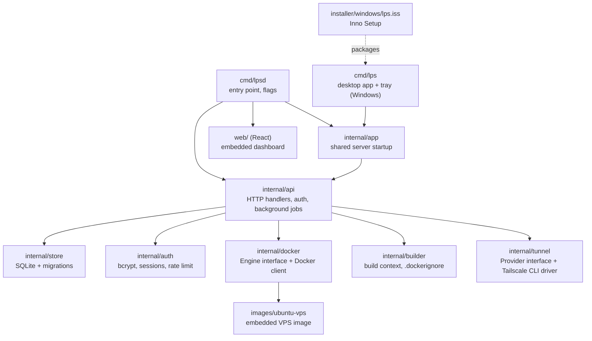

# Development

- [Build from source](#build-from-source)
- [Project layout](#project-layout)
- [Making a release](#making-a-release)
- [Code signing](#code-signing)

## Build from source

### Windows (PowerShell)

Install these first, then **open a new PowerShell window** so the new commands are found:

- [Docker Desktop](https://www.docker.com/products/docker-desktop/) with the WSL2 backend (the default), and start it
- [Go 1.24+](https://go.dev/dl/)
- [Node.js 22 LTS](https://nodejs.org/)
- [Git](https://git-scm.com/download/win)

You don't need `make` on Windows; use `build.ps1` instead:

```powershell
git clone https://github.com/abrardw/lps.git
cd lps
.\build.ps1
.\bin\lpsd.exe serve
```

If PowerShell says **"running scripts is disabled on this system"**, run `powershell -ExecutionPolicy Bypass -File .\build.ps1`. Or allow local scripts for your user once:

```powershell
Set-ExecutionPolicy -Scope CurrentUser RemoteSigned
```

| Task | Command |
|---|---|
| Build and start | `.\build.ps1 run` |
| Run tests | `.\build.ps1 test` |
| Release binaries for every OS | `.\build.ps1 build-all` |
| Installer `dist\LPS-Setup-<version>.exe` (needs [Inno Setup 6](https://jrsoftware.org/isdl.php)) | `.\build.ps1 installer` |
| Clean | `.\build.ps1 clean` |

### Linux / macOS

Needs Go 1.24+, Node.js 22+ and Docker: Docker Engine on Linux (your user must be able to use `/var/run/docker.sock`), or Docker Desktop, OrbStack or Colima on macOS.

```bash
git clone https://github.com/abrardw/lps.git
cd lps
make all
./bin/lpsd serve
```

| Task | Command |
|---|---|
| Run tests | `make test` |
| Debian package | `make deb` |
| macOS package (after `make web`) | `make pkg` |

Then open <http://127.0.0.1:7070> and create the admin account.

## Project layout



- **Frontend:** `web/` (React, Vite, TypeScript, TanStack Query, Tailwind 4, with tokens in `web/src/index.css`). IBM Plex fonts are bundled, so the dashboard works offline. For hot reload, run `npm run dev` in `web/` while `lpsd serve` is running; Vite proxies `/api` to it.
- **Database:** SQLite through the pure-Go `modernc.org/sqlite` driver, so there's no CGO and cross-compiling is easy. Migrations live in `internal/store/migrations` and are applied on start. The SQL is kept portable so PostgreSQL can be added later.
- **Tests:** `internal/docker.Engine` and `internal/tunnel.Provider` are interfaces, and the API tests use in-memory fakes, so `go test ./...` needs neither Docker nor Tailscale.

## Making a release

1. On GitHub, open **Actions → Installers → Run workflow**.
2. Leave **Use workflow from** on `master`, enter the new version (for example `0.2.0`), tick **pre-release** if it is one, and click **Run workflow**.

The workflow tests and builds the installers from `master`, then checks that each one installs, upgrades and uninstalls. Only if everything passes does it create the tag `v0.2.0` and the release. The release has `LPS-Setup-0.2.0.exe`, `lps_0.2.0_amd64.deb`, `lps_0.2.0_arm64.deb` and `LPS-0.2.0-macOS.pkg`, a `.sha256` file for each, and notes generated from the merged pull requests.

The workflow refuses to run:

- with a version that isn't like `1.2.3` or `1.2.3-beta.1`
- for a tag that already exists
- from any branch other than `master`

Leave the version empty to build installers without making a release. Publishing a release by hand in the GitHub UI, or pushing a `v*` tag, also works: the installers are attached to that release.

## Code signing

### Windows

Signing shows who published the installer and stops anyone from changing it unnoticed. SmartScreen and browser warnings fade as the signed installer builds a download reputation. Since 2024, even an EV certificate no longer skips that.

`build.ps1` signs `lps.exe`, `lpsd.exe` and the setup program whenever a `.pfx` certificate is configured:

- **Locally:** set `LPS_SIGN_PFX` to the `.pfx` file and `LPS_SIGN_PASSWORD` to its password, then run `.\build.ps1 installer`.
- **In GitHub Actions:** add the repository secrets `WINDOWS_SIGN_PFX_BASE64` and `WINDOWS_SIGN_PASSWORD`. To base64-encode the `.pfx`, run `[Convert]::ToBase64String([IO.File]::ReadAllBytes("cert.pfx"))`.

A newly bought certificate usually **won't** come as a `.pfx`: since June 2023, certificate authorities must keep code-signing keys on a hardware token or in their cloud signing service. The practical options sign through their own tool or GitHub Action. That tool would replace the *Load the code-signing certificate* step in `.github/workflows/installers.yml`.

- [SignPath Foundation](https://signpath.org/): free for open-source projects. The publisher shown is the SignPath Foundation, naming LPS.
- Microsoft's Azure Trusted Signing: about $10 a month, after Microsoft verifies your identity.
- A certificate authority (DigiCert, Sectigo, SSL.com…) with its cloud signing service: roughly $200–500 a year. A USB token can't be used from GitHub's hosted runners.

### macOS

macOS warns about the package unless it is signed with an Apple Developer ID ($99 a year from the Apple Developer Program). With one, set `LPS_MAC_INSTALLER_IDENTITY` to the "Developer ID Installer: …" identity in your keychain, and `installer/macos/build-pkg.sh` signs the package. For the warning to go away, the package also needs notarizing (`xcrun notarytool submit … --wait`, then `xcrun stapler staple`). The workflow doesn't do either yet.
