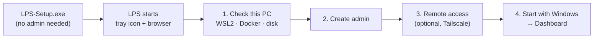
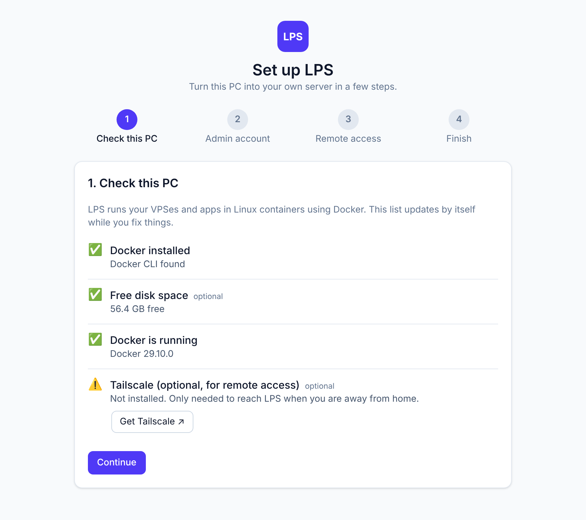

# Installing LPS

Installers are on the [Releases page](https://github.com/AbrarDW/lps/releases). Each one is published with a `.sha256` file next to it so you can check the download.

- [Windows](#windows)
- [Linux (Debian/Ubuntu)](#linux-debianubuntu)
- [macOS](#macos)
- [Updates](#updates)
- [Uninstall](#uninstall)
- [Download blocked?](#download-blocked)

## Windows

Needs Windows 10/11 with WSL2 and Docker Desktop. The setup wizard walks you through both.

1. Download **`LPS-Setup-<version>.exe`**. For a development build, use the latest successful **Installers** run under the repository's *Actions* tab → *Artifacts* → `LPS-windows`.
2. Run it. It installs for your user only into `%LOCALAPPDATA%\Programs\LPS` and doesn't need administrator rights. If Chrome or Windows warns about it, see [Download blocked?](#download-blocked).
3. LPS starts with an icon in the system tray and opens the **setup wizard** in your browser.



The wizard checks everything LPS needs and tells you how to fix what's missing: the exact command to install WSL2, a link to Docker Desktop, and a **Start Docker Desktop** button. The list refreshes by itself while you fix things.



Right-click the **LPS tray icon** for *Open dashboard*, *Start with Windows* and *Quit LPS*. Your VPS and apps keep running in Docker Desktop after you quit LPS.

Data folder: `%ProgramData%\LPS`.

## Linux (Debian/Ubuntu)

Works on Debian, Ubuntu and their derivatives, on 64-bit PCs (`amd64`) and ARM boards such as a Raspberry Pi 4/5 (`arm64`).

1. Install Docker ([Docker Engine](https://docs.docker.com/engine/install/), or `sudo apt install docker.io`). Let your user use it, then sign out and back in:

   ```bash
   sudo usermod -aG docker $USER
   ```

2. Download **`lps_<version>_amd64.deb`** (or `_arm64.deb`) and install it:

   ```bash
   sudo apt install ./lps_*_amd64.deb
   ```

3. LPS starts right away. Open <http://127.0.0.1:7070>; the setup wizard checks Docker and disk space and creates your admin account.

LPS runs as a **systemd user service**: it runs as you, not as root, so it can read your project folders. It starts whenever you sign in. Data folder: `~/.local/share/lps`.

For a home server that should come up at boot before anyone signs in:

```bash
sudo loginctl enable-linger $USER
```

| To… | Run |
|---|---|
| Start LPS for another user (as that user) | `systemctl --user enable --now lps` |
| Stop or restart it | `systemctl --user stop lps` · `systemctl --user restart lps` |
| Follow its log | `journalctl --user -u lps -f` |
| Change its [flags](reference.md#lpsd-serve-flags) | `systemctl --user edit lps`, then add `[Service]`, an empty `ExecStart=` and `ExecStart=/usr/bin/lpsd serve -bind-ip 0.0.0.0` |

On other distributions, [build from source](development.md#build-from-source), or run `make deb` to build the package yourself.

## macOS

Works on macOS 11 or later, on Apple Silicon or Intel (one universal package).

1. Install Docker: [Docker Desktop](https://www.docker.com/products/docker-desktop/), [OrbStack](https://orbstack.dev/) or [Colima](https://github.com/abiosoft/colima). LPS finds their sockets on its own.
2. Download **`LPS-<version>-macOS.pkg`** and open it. It installs `lpsd` into `/usr/local/bin`.
3. LPS starts when the installer finishes, and the setup wizard opens at <http://127.0.0.1:7070>.

The package isn't signed with an Apple Developer ID yet, so the first time you open it macOS says **"Apple could not verify…"**. Open **System Settings → Privacy & Security** and click **Open Anyway**. Or install from Terminal, which skips that check:

```bash
sudo installer -pkg ~/Downloads/LPS-*-macOS.pkg -target /
```

LPS runs as a **launch agent**: it runs as you, not as root, starts whenever you sign in, and restarts if it crashes. Data folder: `~/Library/Application Support/LPS`. Log: `~/Library/Logs/LPS/lpsd.log`.

| To… | Run |
|---|---|
| Stop LPS until you next sign in | `launchctl bootout gui/$(id -u)/com.abrardw.lps` |
| Start it again | `launchctl bootstrap gui/$(id -u) ~/Library/LaunchAgents/com.abrardw.lps.plist` |
| Restart it | `launchctl kickstart -k gui/$(id -u)/com.abrardw.lps` |
| Follow its log | `tail -f ~/Library/Logs/LPS/lpsd.log` |

## Start at sign-in

On Linux and macOS, use the **Start LPS when I sign in** switch on the dashboard (or run `lpsd autostart off`) to turn autostart off and on. On Windows, use **Start with Windows** in the tray menu.

## Updates

LPS checks GitHub for a new release twice a day and shows a banner when there is one. The check only asks GitHub for the latest release; nothing about you or your PC is sent. To turn automatic checks off, or to check now, go to **Account → Updates**, or start LPS with `lpsd serve -no-update-check`.

- **Windows:** click **Install update**. LPS downloads the new installer, checks its published SHA-256, installs it silently and restarts.
- **Linux / macOS:** download the new `.deb` or `.pkg` and install it the same way as before.

Your VPS and apps keep running in Docker during an update.

## Uninstall

| OS | How |
|---|---|
| Windows | Settings → Apps → *LPS - Local Personal Server* |
| Linux | `sudo apt remove lps` |
| macOS | `sudo lps-uninstall` |

Uninstalling keeps your data folder and the VPS and apps in Docker, so a reinstall picks them up. To remove everything, delete the data folder too.

## Download blocked?

The installers are built in the open by GitHub Actions from this repository, but they aren't code-signed yet. Browsers and Windows warn about unsigned programs that few people have downloaded:

| Where | What it says | What to do |
|---|---|---|
| Chrome | *"LPS-Setup… isn't commonly downloaded"* or *"…may be dangerous"* | Open the downloads list (**Ctrl+J**), then choose **Keep** (or **⋮ → Download dangerous file**). |
| Edge | *"…isn't commonly downloaded"* | **⋯ → Keep → Show more → Keep anyway**. |
| Windows SmartScreen | *"Windows protected your PC"* | **More info → Run anyway**. |

To check that you have the genuine file, compare its SHA-256 with the published `.sha256` file:

```powershell
Get-FileHash -Algorithm SHA256 .\LPS-Setup-*.exe
```

Or build the installer yourself with `.\build.ps1 installer` (see [Build from source](development.md#build-from-source)).
