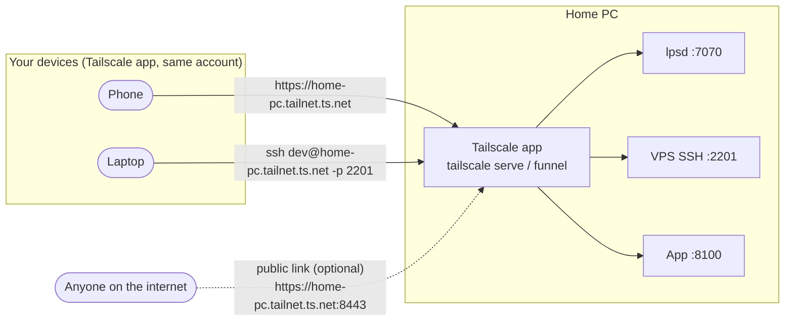
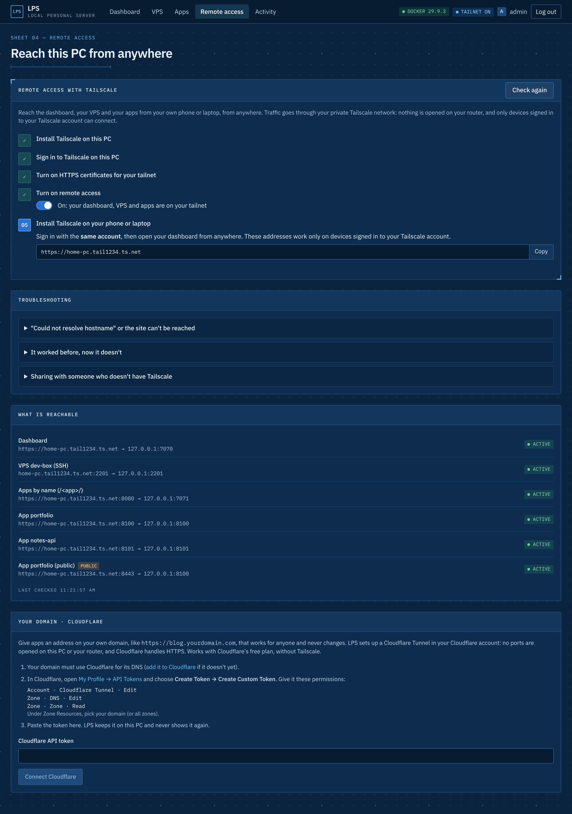
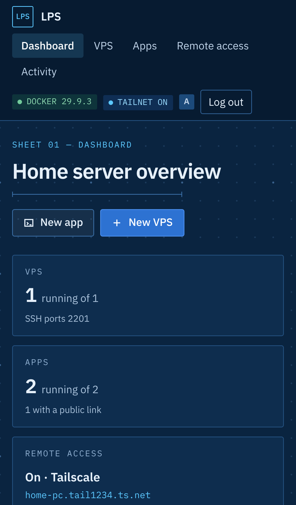
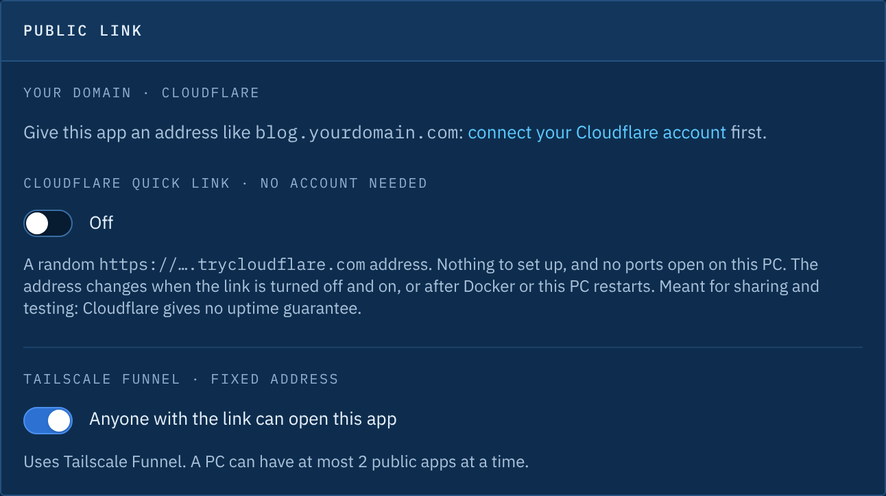
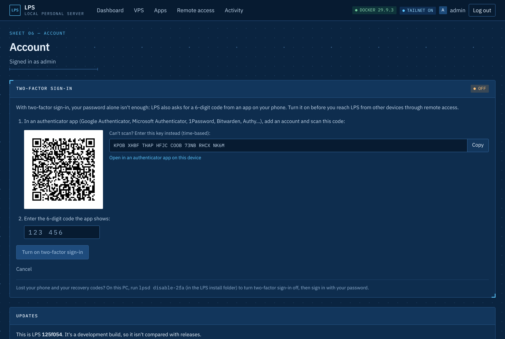

# Remote access

Everything LPS publishes listens on `127.0.0.1` by default. To reach it from elsewhere, pick one of these:

| Option | Reaches | Who can open it | Needs |
|---|---|---|---|
| [Tailscale](#tailscale) | Dashboard, SSH, apps | Your own devices (plus up to 2 public app links) | Free Tailscale account |
| [Cloudflare quick link](#cloudflare-quick-links) | One app | Anyone with the random address | Nothing |
| [Your own domain](#your-own-domain-cloudflare-tunnel) | Apps | Anyone | A domain on Cloudflare DNS |

Before you reach LPS from other devices, turn on [two-factor sign-in](#two-factor-sign-in).

## Tailscale

Reach the dashboard, SSH into your VPS and open your apps from your phone or laptop, from anywhere, without a domain or router changes.



**Set up (about 5 minutes):**

1. Install the [Tailscale app](https://tailscale.com/download) on the home PC and sign in.
2. In the Tailscale admin console, open [DNS](https://login.tailscale.com/admin/dns) and enable **HTTPS Certificates**.
3. In LPS, open **Remote access** and turn it on. LPS publishes the dashboard, every VPS's SSH port and every app on your tailnet, and keeps that in sync as you add or delete things.
4. On your phone or laptop, install Tailscale, sign in with the same account, and open the dashboard address LPS shows (like `https://home-pc.your-tailnet.ts.net`).



The dashboard works on a phone too:



**What gets published:**

| What | Address on your tailnet | Who can reach it |
|---|---|---|
| Dashboard | `https://<pc>.<tailnet>.ts.net` | Your Tailscale devices (you still sign in to LPS) |
| VPS SSH | `ssh <user>@<pc>.<tailnet>.ts.net -p 22xx` | Your Tailscale devices |
| Apps | `https://<pc>.<tailnet>.ts.net:81xx` | Your Tailscale devices |
| App public link (opt-in) | `https://<pc>.<tailnet>.ts.net:8443` or `:10000` | **Anyone** with the link (Tailscale Funnel) |

**Good to know:**

- Public links use [Tailscale Funnel](https://tailscale.com/kb/1223/funnel), which allows only a few ports per machine, so **at most 2 apps can be public at once**. Funnel must be allowed for your tailnet. The dashboard and SSH are never made public.
- LPS only adds and removes the `tailscale serve`/`funnel` settings it created. If one of your own Tailscale settings already uses a port, LPS leaves it alone and shows a warning.
- Tailscale forwards to `127.0.0.1`, so nothing is opened on your LAN or router.
- Start lpsd with `-no-remote` to turn the integration off.

**Troubleshooting:**

- **"Could not resolve hostname", or the site can't be reached:** the device must have Tailscale connected and signed in to the **same account** as the home PC. `*.ts.net` addresses don't exist for other devices. On a Mac, keep **Use Tailscale DNS settings** on, and turn off other VPNs and iCloud Private Relay.
- **It worked before but doesn't now:** the home PC must be on and awake, with Docker, Tailscale and lpsd running. Click **Check again** on the Remote access page and look for errors.
- **A public link doesn't open:** it can take about a minute to start working.

## Public links

Every app's **Public link** card offers all three ways to share it outside your own devices: your own domain, a Cloudflare quick link and a Tailscale Funnel link.



## Cloudflare quick links

You can share an app with anyone without Tailscale or a Cloudflare account. On the app's page, turn on **Public link → Cloudflare quick link**. A few seconds later the app has an address like `https://some-random-words.trycloudflare.com`.

- LPS runs Cloudflare's `cloudflared` ([Quick Tunnel](https://developers.cloudflare.com/cloudflare-one/connections/connect-apps/do-more-with-tunnels/trycloudflare/)) in a small container (`lps-cf-<app>`) next to the app. The first time, Docker downloads its image (about 100 MB). The tunnel connects **out** to Cloudflare, so no ports are opened on this PC or your router.
- It works for container apps and for apps in a VPS. The address stays the same across redeploys. It changes if you turn the link off and on again, or after Docker or the PC restarts.
- Anyone with the address can open the app. The dashboard and SSH are never shared this way.
- Quick links are for demos and testing: Cloudflare gives them no uptime guarantee and limits what they support (for example, no Server-Sent Events). For a fixed address, use your own domain.

## Your own domain (Cloudflare Tunnel)

You can give apps a permanent address on a domain you own, like `https://blog.yourdomain.com`, with HTTPS from Cloudflare. This works on Cloudflare's free plan and doesn't need Tailscale.

1. The domain must use Cloudflare for its DNS ([add it to Cloudflare](https://dash.cloudflare.com/) if it doesn't yet).
2. In Cloudflare, open **My Profile → API Tokens → Create Token → Create Custom Token** and give it these permissions for your domain:
   - Account · Cloudflare Tunnel · Edit
   - Zone · DNS · Edit
   - Zone · Zone · Read
3. In LPS, open **Remote access → Your domain · Cloudflare**, paste the token and click **Connect Cloudflare**.
4. On an app's page, under **Public link → Your domain**, enter an address such as `blog.yourdomain.com` and click **Use this address**.

How it works:

- LPS creates a Cloudflare Tunnel in your account (named `lps-<pc>-…`) and runs its connector in a container (`lps-cf-tunnel`). The connector only connects **out** to Cloudflare.
- For each address, LPS adds a proxied `CNAME` record with the comment *Managed by LPS*, plus a route to the app. LPS never touches DNS records it didn't create. If the address already has a record, LPS asks you to remove it first or pick another name.
- **Remove** on an app deletes its record and route. **Disconnect** deletes every record LPS made, the connector and the tunnel.
- The API token is stored in LPS's database on this PC and is never shown again.

## Two-factor sign-in

Open **Account** (click your name at the top right) → **Turn on two-factor sign-in**. Scan the QR code with an authenticator app (Google Authenticator, Microsoft Authenticator, 1Password, Bitwarden, Authy…) and enter the code it shows. From then on, signing in needs your password and a 6-digit code.



You also get **10 recovery codes**. Save them: each one signs you in once if you don't have your phone. You can make new ones on the Account page.

**Lost your phone and your recovery codes?** On the PC where LPS runs, turn two-factor sign-in off from a terminal, then sign in with your password:

```powershell
& "$env:LOCALAPPDATA\Programs\LPS\lpsd.exe" disable-2fa
```

On Linux and macOS, run `lpsd disable-2fa`. Add `-data DIR` if you use a custom data folder, and `-user NAME` if there is more than one account.
