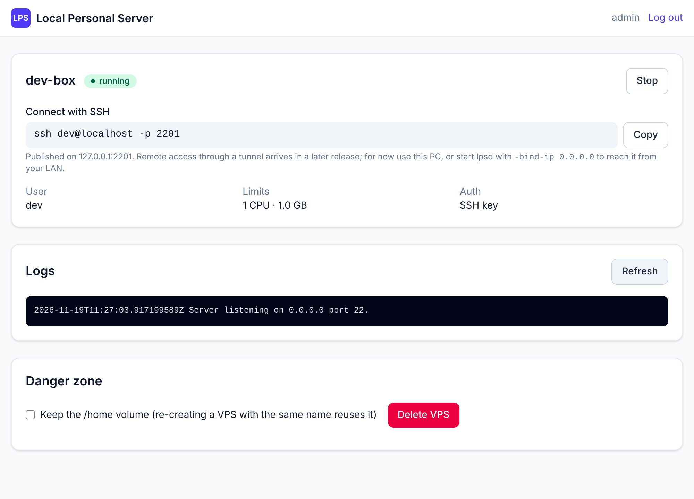
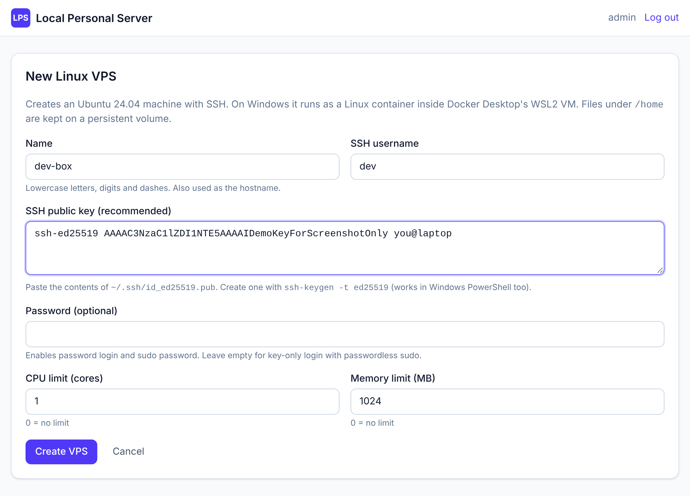
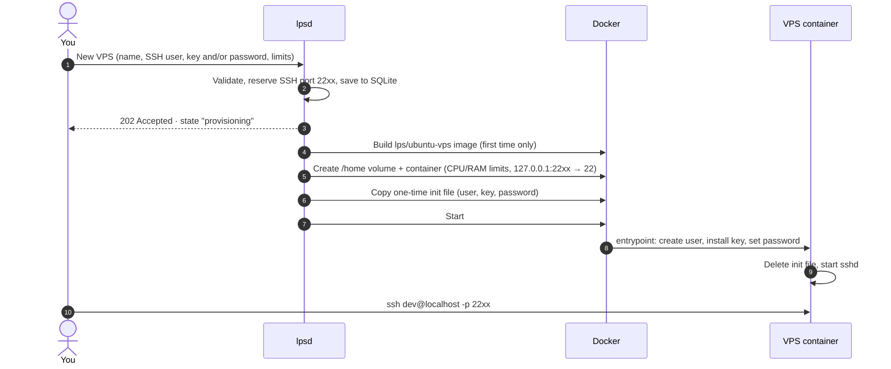
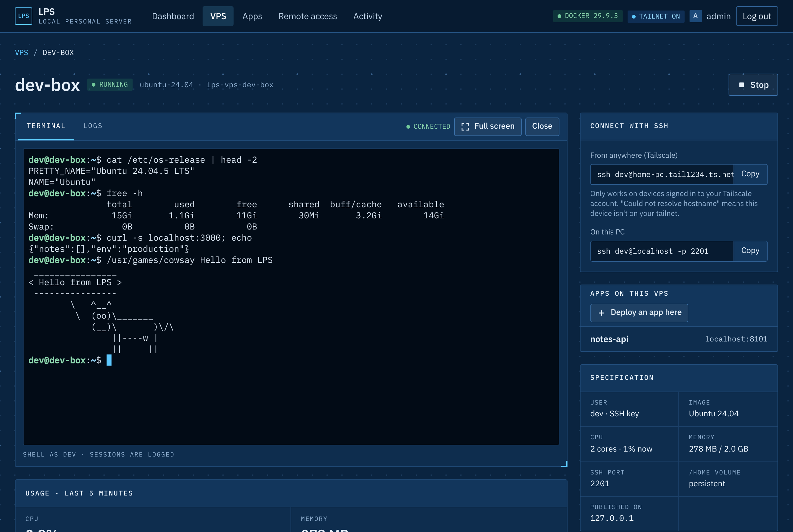
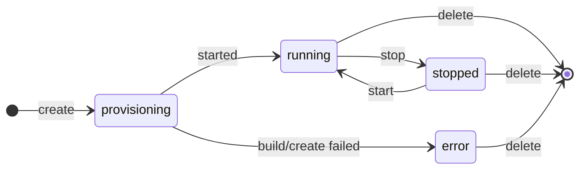

# Linux VPS

Each VPS is an Ubuntu 24.04 container with `sshd`. It has:

- its own SSH user (key or password), with passwordless sudo for key-only accounts
- CPU and memory limits
- a persistent `/home` volume that survives restarts and can be kept when you delete the VPS

You SSH in, `apt install`, `git clone` and run things just as you would on a rented VPS.



## Creating a VPS

Click **New VPS**, choose a name and paste your SSH public key (`ssh-keygen -t ed25519` creates one, including in PowerShell). Building the Ubuntu image for the first VPS takes a few minutes. After that you get a command like:

```bash
ssh dev@localhost -p 2201
```



<details>
<summary>What happens behind the scenes</summary>



</details>

When you delete a VPS you can keep its `/home` volume. If you later create a VPS with the same name, it picks the volume up again.

## Terminal in the browser

On a running VPS's **Terminal** card, click **Open terminal** to get a shell as the VPS's user right in the dashboard. You don't need an SSH client or keys, and it works from your phone too over [remote access](remote-access.md). It supports colours, full screen and resizing (`vim` and `htop` work), and `sudo` behaves exactly as it does over SSH.



Only the signed-in admin can open a terminal. The WebSocket refuses cross-site requests (it checks the Origin, and the session cookie is SameSite=Strict), and each session is logged.

## Snapshots

The **Snapshots** card on a VPS page saves **everything** in the VPS: installed software and settings (the container's files, saved as an image) and a copy of `/home`. Snapshots stay in Docker on this PC.

- **Take snapshot** works while the VPS runs; the VPS is paused only while its files are saved. For something that writes all the time, such as a database, stop the VPS first to get a fully consistent copy.
- **Restore** puts the VPS back exactly as it was: files, users, passwords, SSH keys and host keys. LPS snapshots the current state first, so you can undo a restore. Apps running in the VPS come back on their own.
- **New VPS from it** makes a copy with a new name and SSH port.
- **Delete** removes a snapshot. Deleting a VPS deletes its snapshots too.
- **Automatic snapshots:** choose **Every day** or **Every week**, the hour (in this PC's time) and how many to keep. If the PC was off at that hour, LPS takes one when it next starts. Only automatic snapshots (marked *auto*) are pruned.
- **Export to file** saves a snapshot as a compressed `.lpsnap` file in LPS's data folder (`exports`), which you can **Download** or copy anywhere.
- **Create from a file:** **New VPS → Or create it from a snapshot file** restores a `.lpsnap` file (from this PC or another one) as a new VPS with its own SSH port. Use this to move a VPS to another PC.

## Lifecycle



## Limits compared with a real VM

A VPS here is a container, not a full VM:

- It shares the host's Linux kernel (WSL2's kernel on Windows).
- `systemd` isn't running, so start services with their own commands or a process manager like `supervisord` or `pm2`.
- Running Docker inside a VPS isn't supported yet.
- CPU limits are quotas, so `nproc` still shows every host core.
